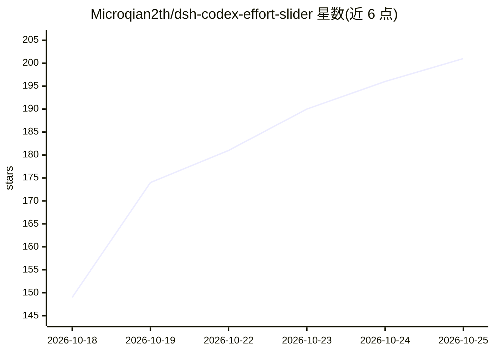

# Microqian2th/dsh-codex-effort-slider

⭐ 201 · JavaScript · MIT · 推送 2026-10-18 · [GitHub](https://github.com/Microqian2th/dsh-codex-effort-slider) · 个人维护 · 中文 README

**DeepSeek Harness 的推理等级滑条插件：可拖动连续调档带渐变特效**

面向 DeepSeek Harness（DSH）Desktop 的 UI 插件：把官方模型菜单里的「推理等级」一行改造为可拖动连续滑条，拖动即时切档，填充色由蓝渐变至紫，高档位显示星云与星尘粒子动画，数值文字同步变色（Off 档保持官方灰）。通过 react-dom portal 注入 DOM，读写走官方公开接口 directoryFor/select；依赖官方语义锚点（aria 属性），官方改版时静默不生效（fail-open），不注册宿主钩子。零运行时依赖、无构建步骤，提供 npm/面板/脚本三种安装方式，需重启 DSH Desktop 生效，附 272 项离线断言测试与无需安装的在线试玩预览页。

## 筛选速览

| 维度 | 判定 | 备注 |
|---|---|---|
| AI 角色 | `ai-ecosystem` | LLM/agent 周边工具 |
| 许可风险 | `permissive` | MIT |
| 部署形态 | `library` | 以包/库形式分发 |
| 模型依赖 | — | README 未给出锁定关系 |
| 硬件要求 | — | 无带数字的原话,不猜 |
| 安装摩擦 | `low` | 无编译、无系统依赖或容器化 |
| 成熟度 | — | 结构信号不足 |

## 能力要点

- 把官方推理等级行改造为跟手连续滑条，拖到即切档
- 位置驱动的色彩/能量/粒子系统（高档位星云+22颗星尘，对比度经校验）
- fail-open：锚点认不出即静默不生效，不动官方界面；不注入消息不注册钩子
- 零运行时依赖、无构建步骤；含无需安装的 preview/panel.html 试玩页

## 适用场景

- 在 DSH Desktop 里拖滑条快速切换模型推理等级
- 不安装先通过 preview 页面预览滑条观感
- 打包 zip 分发给其他 DSH 用户离线安装

## 场景标签

 · 领域:AI 客户端插件/UI 组件

## 证据(README 行号)

> L5: 给 DeepSeek Harness（DSH）用的 **Codex 风格推理等级滑条**。
> L45: 它不新增入口：**直接改造官方模型菜单里的「推理等级」那一行** ——
> L181: |读档位|`directoryFor(sessionId).store.getSnapshot()` → `groups[].models[].reasoning.efforts`|

## 星数曲线

2026-10-18 149 → 2026-10-25 201（+52）

---
*卡片 v1 · prompt 1.4 · 生成 2026-10-22 · 置信度 high · 依据 README sha `6d51fbfa3f6e` · [字段定义](../../DATASET.md)*
