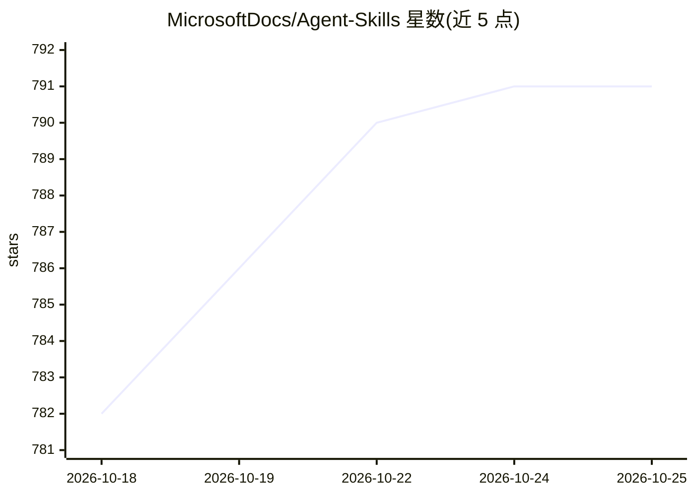

# MicrosoftDocs/Agent-Skills

⭐ 791 · CC-BY-4.0 · 推送 2026-10-19 · [GitHub](https://github.com/MicrosoftDocs/Agent-Skills) · [官网](https://learn.microsoft.com/) · 组织维护

**面向 Azure 开发的策展 Agent 技能库：193 个 SKILL.md 技能**

MicrosoftDocs 维护的 Azure 开发 agent 技能集合：从 Microsoft Learn 文档中提取决策、流程与约束，预编译为结构化的 SKILL.md 技能（含文档链接、最佳实践、排错指南），按 19 类 Azure 服务域组织共 193 个技能，并提供 10 个按角色划分的技能包。技能遵循 Agent Skills 开放标准，采用渐进式披露三级加载机制，支持 Claude Code、Gemini CLI、Codex CLI、GitHub Copilot、Cursor 等 8 种 AI 编码助手，可通过插件市场一键安装或手动 git clone 复制 skills 目录。

## 筛选速览

| 维度 | 判定 | 备注 |
|---|---|---|
| AI 角色 | `ai-knowledge` | 知识聚合/清单类 |
| 许可风险 | `viral` | CC-BY-4.0 |
| 部署形态 | `None` |  |
| 模型依赖 | — | README 未给出锁定关系 |
| 硬件要求 | — | 无带数字的原话,不猜 |
| 安装摩擦 | `low` | 无编译、无系统依赖或容器化 |
| 成熟度 | — | 结构信号不足 |

## 能力要点

- 193 个技能覆盖 19 个 Azure 服务域（Compute/Integration/AI & ML 等）
- 遵循 Agent Skills 开放标准，兼容 8 种 AI 编码助手
- VS Code / Claude Code / Codex 支持插件市场一键安装
- 渐进式披露三级加载：YAML 描述→SKILL.md→附加资源

## 适用场景

- 让我的 AI 编码助手获得 Azure 服务的最新官方文档知识
- 按角色（数据工程师/安全合规/DevOps）选择技能包快速上手
- 在 Claude Code 或 Cursor 中通过自然语言调用 Azure 排错与配置技能

## 场景标签

`精选清单` `提示工程` · 领域:Agent 开发

## 证据(README 行号)

> L23: Azure Agent Skills is a curated collection of **high-quality agentic skills** specifically designed for Azure cloud
> L39: Microsoft Learn documentation already encodes **decisions, procedures, best practices, and constraints** — exactly 
> L205: **Total: 193 skills across 19 categories** ✓

## 星数曲线

2026-10-18 782 → 2026-10-25 791（+9）

---
*卡片 v1 · prompt 1.4 · 生成 2026-10-21 · 置信度 high · 依据 README sha `60b86c90044b` · [字段定义](../../DATASET.md)*
