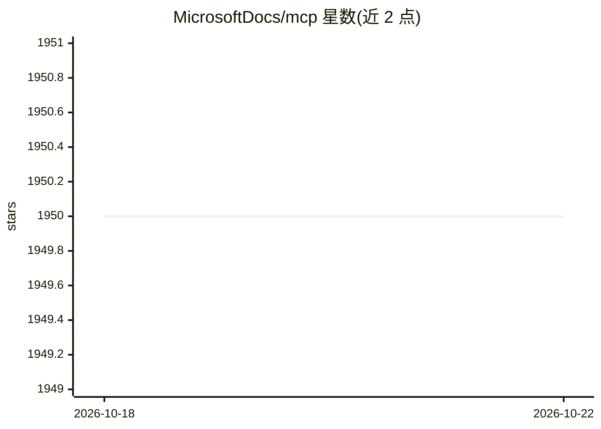

# MicrosoftDocs/mcp

⭐ 1,952 · TypeScript · CC-BY-4.0 · 推送 2026-10-21 · [GitHub](https://github.com/MicrosoftDocs/mcp) · [官网](https://learn.microsoft.com) · 组织维护

**为 AI 助手/Agent 接入微软官方文档检索的 MCP 服务与 CLI**

微软官方提供的 MCP Server 与配套 CLI：通过远程 MCP 端点（learn.microsoft.com/api/mcp）向 Claude、Cursor、Copilot、Codex 等客户端提供三个工具——微软官方文档语义搜索、文档页转 Markdown 抓取、官方代码示例搜索。免 API key，支持 VS Code/Claude Code 插件一键安装及各客户端手动配置。附带 npm CLI（@microsoft/learn-cli）可在终端直接使用同类检索，并提供三个 Agent Skills 指导代理使用工具。实验特性含 OpenAI 兼容端点与 maxTokenBudget 参数。

## 筛选速览

| 维度 | 判定 | 备注 |
|---|---|---|
| AI 角色 | `ai-ecosystem` | LLM/agent 周边工具 |
| 许可风险 | `viral` | CC-BY-4.0 |
| 部署形态 | `library` | 以包/库形式分发 |
| 模型依赖 | — | README 未给出锁定关系 |
| 硬件要求 | — | 无带数字的原话,不猜 |
| 安装摩擦 | `medium` | 含编译或系统依赖之一 |
| 成熟度 | `idea` | |

## 能力要点

- 远程 MCP 端点，免 key、免登录接入
- 三个工具：文档语义搜索、页面转 Markdown、代码示例搜索（可按语言过滤）
- npm CLI（npx @microsoft/learn-cli）终端直用，支持 --json 结构化输出
- 提供三个 Agent Skills（microsoft-docs / microsoft-code-reference / microsoft-skill-creator）

## 适用场景

- 让我的编程助手实时查微软/Azure 官方文档，避免编造 API
- 在 Claude Code、Copilot CLI、Cursor 等客户端一键接入微软文档检索
- 在终端用 CLI 搜索官方文档与代码示例并接脚本处理

## 场景标签

`语义搜索` `网页抓取` · 领域:效率与自动化

## 证据(README 行号)

> L36: The Microsoft Learn MCP Server is accessible to any IDE, agent, or tool that supports the Model Context Protocol (M
> L81: |`microsoft_docs_search`|Performs semantic search against Microsoft official technical documentation|`query` (strin
> L89: The `@microsoft/learn-cli` package gives you terminal access to the same tools — search docs, fetch pages, and find

## 星数曲线

2026-10-18 1,950 → 2026-10-22 1,950（+0）

---
*卡片 v1 · prompt 1.4 · 生成 2026-10-21 · 置信度 high · 依据 README sha `c7911393402a` · [字段定义](../../DATASET.md)*
