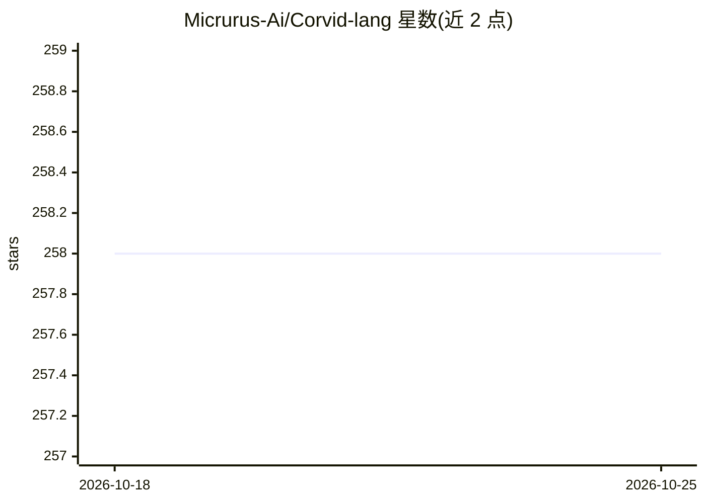

# Micrurus-Ai/Corvid-lang

⭐ 258 · Rust · MIT · 推送 2026-07-24 · [GitHub](https://github.com/Micrurus-Ai/Corvid-lang) · 组织维护

**面向 AI 原生软件的通用编程语言，编译期检查 AI 行为**

Corvid 是一门通用编程语言，将 agent、tool、prompt、approve、模型路由、预算、置信度等 AI 构造纳入语言与编译器：缺少审批边界、组合成本超限或 Grounded 返回缺溯源链时程序拒绝编译。提供 curl 安装脚本与 cargo 源码安装，安装器可自动装 VS Code/Cursor/Windsurf 扩展；另有签名 cdylib 构建、claim/ABI 校验、replay 与收据、基于 skill.toml 的技能权限审计等机制。面向编写 CLI、服务器、数据管道与 AI agent 的开发者。README 各机制均标注 spec、tour、测试与非目标边界。

## 筛选速览

| 维度 | 判定 | 备注 |
|---|---|---|
| AI 角色 | `ai-ecosystem` | LLM/agent 周边工具 |
| 许可风险 | `permissive` | MIT |
| 部署形态 | `library` | 以包/库形式分发 |
| 模型依赖 | — | README 未给出锁定关系 |
| 硬件要求 | — | 无带数字的原话,不猜 |
| 安装摩擦 | `low` | 无编译、无系统依赖或容器化 |
| 成熟度 | — | 结构信号不足 |

## 能力要点

- 审批门、成本预算、Grounded<T> 溯源等编译期契约
- agent/tool/prompt/effect 等为编译器可理解的关键字
- 签名 cdylib 构建与独立 ABI 描述符校验、DSSE 收据
- 技能 skill.toml 声明权限上限，安装时计算审计并拒绝不实标签

## 适用场景

- 编写需审批边界与成本上限的 AI agent 工作流
- 构建带溯源与引用契约的检索问答程序
- 需要可重放执行与签名收据的可审计 AI 服务
- 以权限标签方式审计 agent 技能的能力边界

## 场景标签

 · 领域:编程语言/AI 工程基础设施

## 证据(README 行号)

> L3: Corvid is a general-purpose programming language built for AI-native software.
> L5: Python, TypeScript, Rust, Go, and JavaScript can call models through libraries. Corvid makes the AI parts visible to
> L7: The goal is not to be a RAG DSL. The goal is a real language for CLIs, servers, data pipelines, automation, embedded

## 星数曲线

2026-10-18 258 → 2026-10-25 258（+0）

---
*卡片 v1 · prompt 1.4 · 生成 2026-10-22 · 置信度 high · 依据 README sha `b9c43946b601` · [字段定义](../../DATASET.md)*
