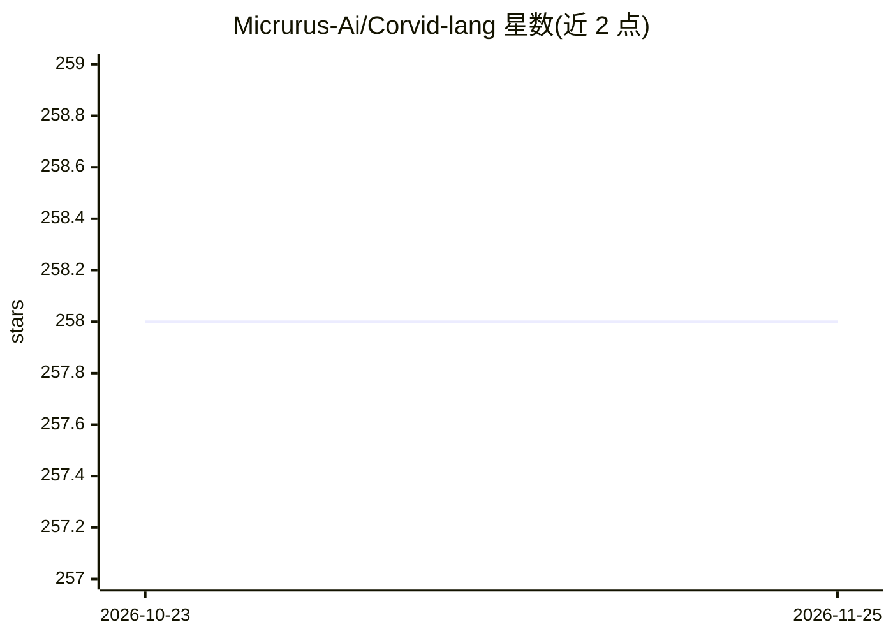

# Micrurus-Ai/Corvid-lang

⭐ 258 · Rust · MIT · 推送 2026-11-23 · [GitHub](https://github.com/Micrurus-Ai/Corvid-lang) · 组织维护

**面向 AI 原生软件的编程语言：把 AI 边界交给编译器检查**

Corvid 是一门通用编程语言，将 agent、tool、prompt、approve、预算、置信度、模型路由、streaming、replay、verification 等作为语言构造暴露给编译器。删除 approve 行、组合成本超上限、Grounded<T> 缺少检索溯源都会导致编译失败；另提供 DSSE 签名的 cdylib 构建与 ABI 验证命令、trace 断言式 eval、可回放执行记录，以及按权限标签安装并持续重校验的技能系统。目标用户是编写 CLI、服务器、数据管道与 AI agent 的开发者。通过安装脚本分发，支持 cargo 从源码安装，安装器附带编辑器扩展。

## 筛选速览

| 维度 | 判定 | 备注 |
|---|---|---|
| AI 角色 | `ai-ecosystem` | LLM/agent 周边工具 |
| 许可风险 | `permissive` | MIT |
| 部署形态 | `library` | 以包/库形式分发 |
| 模型依赖 | local-ok | 支持本地模型 |
| 硬件要求 | — | 无带数字的原话,不猜 |
| 安装摩擦 | `low` | 无编译、无系统依赖或容器化 |
| 成熟度 | — | 结构信号不足 |

## 能力要点

- approve/成本/溯源/置信度等约束在编译期检查
- Grounded<T> 溯源传播与严格引用契约
- @budget 静态预算与 trace 断言式 eval
- 签名 cdylib 构建产物与 ABI 验证工具链

## 适用场景

- 为调用模型的 CLI、服务器和数据管道提供编译期安全约束
- 对不可逆操作（如退款）强制审批边界
- 限制 AI 工作流的成本上限并保留可回放审计记录
- 安装技能时按声明的能力上限做自动审计

## 场景标签

 · 领域:编程语言/AI 基础设施

## 证据(README 行号)

> L3: Corvid is a general-purpose programming language built for AI-native software.
> L5: Python, TypeScript, Rust, Go, and JavaScript can call models through libraries. Corvid makes the AI parts visible to

## 星数曲线

2026-10-23 258 → 2026-11-25 258（+0）

---
*卡片 v1 · prompt 1.4 · 生成 2026-11-25 · 置信度 high · 依据 README sha `87a905aefeb3` · [字段定义](../../DATASET.md)*
