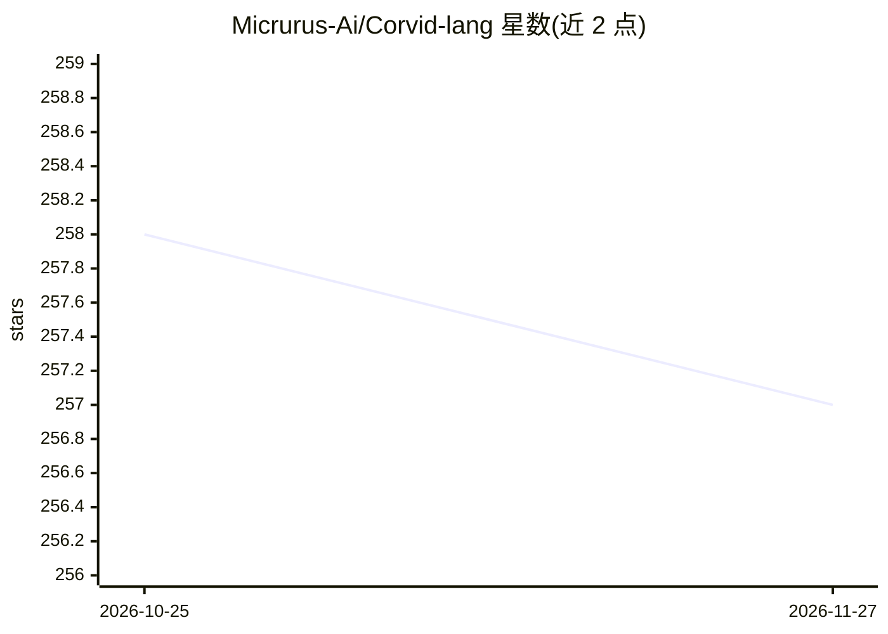

# Micrurus-Ai/Corvid-lang

⭐ 257 · Rust · MIT · 推送 2026-11-26 · [GitHub](https://github.com/Micrurus-Ai/Corvid-lang) · 组织维护

**让开发者用类型化语法构建含 AI 的全栈应用的编程语言**

Corvid 是一门处于 pre-1.0 阶段的通用编程语言，目标是用同一语言编写界面、后端与 AI 层：类型与表一次声明即被数据库、后端、界面与 agent 共用；提示词返回声明类型，回复不匹配时把错误回传模型重试；模型调用、工具调用与审批被记录，可用 corvid replay 复现；不可逆工具调用需 approve 步骤，检索值以 Grounded<T> 携带来源；成本预算、评测、fixture 与 mock 属于语言本身。通过 curl 安装脚本分发，附带 VS Code 系编辑器扩展。

## 筛选速览

| 维度 | 判定 | 备注 |
|---|---|---|
| AI 角色 | `ai-ecosystem` | LLM/agent 周边工具 |
| 许可风险 | `permissive` | MIT |
| 部署形态 | `library` | 以包/库形式分发 |
| 模型依赖 | — | README 未给出锁定关系 |
| 硬件要求 | — | 无带数字的原话,不猜 |
| 安装摩擦 | `low` | 无编译、无系统依赖或容器化 |
| 成熟度 | `idea` | |

## 能力要点

- 提示词返回声明类型，不匹配时带错误重试并计入预算
- 记录模型/工具调用与审批，corvid replay 无模型调用复现结果
- 不可逆工具需 approve 步骤，注入文本经 taint 检查在编译期报错
- 从类型化契约生成 TypeScript 客户端与 Swift/Kotlin/Python SDK

## 适用场景

- 用一门语言构建带 agent 的全栈 Web 应用与 HTTP 服务
- 为 AI 功能做编译期成本预算与不可逆操作审批控制
- 录制并回放 AI 运行轨迹用于调试与测试

## 场景标签

 · 领域:编程语言/AI 应用开发

## 证据(README 行号)

> L5: Corvid is a general-purpose programming language. A small app takes a few lines, and a team can build a large AI app
> L108: - **Agents** with typed tools, approvals, budgets, step limits, evaluations and replay. Prompts

## 星数曲线

2026-10-25 258 → 2026-11-27 257（-1）

---
*卡片 v1 · prompt 1.4 · 生成 2026-11-26 · 置信度 mid · 依据 README sha `fa310e01b262` · [字段定义](../../DATASET.md)*
