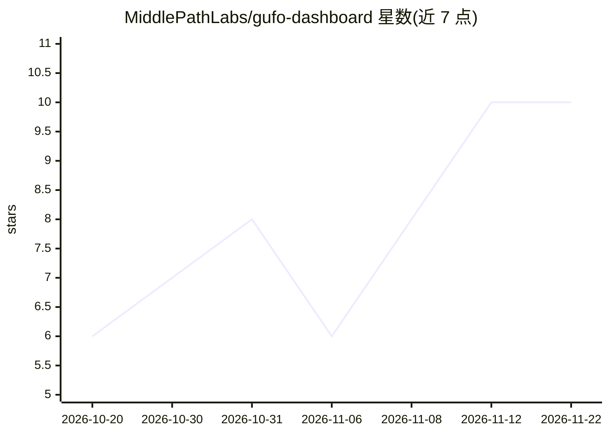

# MiddlePathLabs/gufo-dashboard

⭐ 10 · Python · MIT · 推送 2026-11-11 · [GitHub](https://github.com/MiddlePathLabs/gufo-dashboard) · 个人维护

**本地统计面板与代理，为 Gufo 推理服务器记录用量与延迟**

面向自托管 Gufo 推理服务器的本地仪表盘与 HTTP/SSE/WebSocket 代理：客户端经 8081 端口路由，面板按模型分别统计 token 用量、吞吐、首 token 时间、缓存命中与 speculative decoding 数据，存入 SQLite（可配置保留期与按日汇总）。支持 OpenAI 兼容端点与 Gufo 原生端点，可选内容捕获用于问答审计（默认关闭、独立保留期与删除控制），并展示 Linux CPU/RAM 与 AMD GPU 读数。需已运行的 Gufo 服务器；无内置认证与 TLS，仅适合可信本地或私有网络部署。

## 筛选速览

| 维度 | 判定 | 备注 |
|---|---|---|
| AI 角色 | `ai-ecosystem` | LLM/agent 周边工具 |
| 许可风险 | `permissive` | MIT |
| 部署形态 | `self-host` | docker 或自建部署 |
| 模型依赖 | — | README 未给出锁定关系 |
| 硬件要求 | — | 无带数字的原话,不猜 |
| 安装摩擦 | `low` | 无编译、无系统依赖或容器化 |
| 成熟度 | — | 结构信号不足 |

## 能力要点

- HTTP/SSE/WebSocket 代理并按模型记录 token 用量、吞吐、首 token 时间、缓存命中
- SQLite 存储、可配置保留期与按日汇总，支持数据清除与备份
- 可选问答内容捕获（默认关闭）带独立保留期与删除控制
- Live 视图显示引擎/主机读数与 Linux CPU、RAM、AMD GPU 利用率

## 适用场景

- 自托管 Gufo 推理服务器后追踪各模型的 token 用量与延迟变化
- 对比 prompt 缓存命中与未命中时的首 token 时间中位数
- 对经过代理的问答流量做审计并按保留期自动清理
- 在私有网络内代理 OpenAI 兼容客户端而不改动其模型与凭据配置

## 场景标签

`LLM 可观测性` · 领域:评测与运维

## 证据(README 行号)

> L3: A local statistics dashboard and HTTP, SSE, and WebSocket proxy for Gufo
> L5: throughput, latency, cache hits, and speculative decoding over time.
> L14: - Tracks requests across Chat Completions, Completions, Responses, Messages, and

## 星数曲线

2026-10-20 6 → 2026-11-22 10（+4）

---
*卡片 v1 · prompt 1.4 · 生成 2026-11-20 · 置信度 high · 依据 README sha `55b4bbfb7a96` · [字段定义](../../DATASET.md)*
