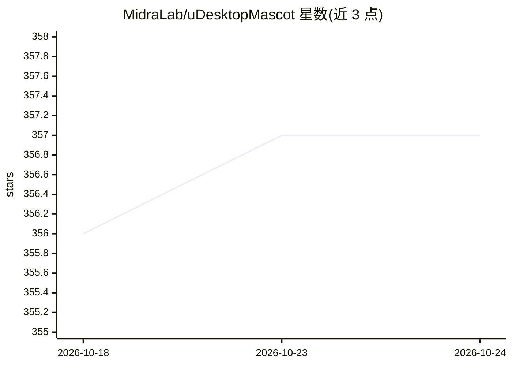

# MidraLab/uDesktopMascot

⭐ 358 · C# · Apache-2.0 · 推送 2026-03-15 · [GitHub](https://github.com/MidraLab/uDesktopMascot) · 组织维护

**Unity 桌面宠物应用：VRM 模型显示与离线语音 AI 聊天**

开源 Unity 桌面宠物应用，支持 Windows 10/11 与 macOS。读取 VRM(1.x/0.x)、GLB/GLTF、FBX 模型显示在桌面上，可自定义菜单背景、颜色与纹理；支持语音与 BGM 播放。AI 部分：集成离线语音识别引擎 Vosk 实时转写麦克风输入，结果发送给 LLM 生成回答并由角色朗读；声学模型与量化 GGUF 模型置于 StreamingAssets 可离线运行。通过 Releases 提供构建版本，也可用 Unity 6000.1.1f1 自行构建并用 Inno Setup/productbuild 制作安装包。

## 筛选速览

| 维度 | 判定 | 备注 |
|---|---|---|
| AI 角色 | `ai-enhanced` | 去掉 AI 部分产品仍成立 |
| 许可风险 | `permissive` | Apache-2.0 |
| 部署形态 | `desktop` | 安装包/桌面程序 |
| 模型依赖 | — | README 未给出锁定关系 |
| 硬件要求 | — | 无带数字的原话,不猜 |
| 安装摩擦 | `low` | 无编译、无系统依赖或容器化 |
| 成熟度 | — | 结构信号不足 |

## 能力要点

- 支持 VRM/GLB/GLTF/FBX 模型加载与桌面显示
- Vosk 离线语音识别，静音 1 秒后确认文本并发送 LLM
- 声学模型与量化 GGUF 模型放 StreamingAssets 即可离线运行多语言对话
- 角色应答朗读，应答生成中自动暂停麦克风防误识别

## 适用场景

- 在桌面上常驻显示自己的 VRM 角色模型
- 通过语音或文本与桌面角色进行 AI 对话
- 自定义菜单背景、纹理与角色语音/BGM

## 场景标签

`语音 Agent` · 领域:对话与助手

## 证据(README 行号)

> L16: 「uDesktopMascot」は、`創作の自由化` をテーマにした デスクトップマスコットアプリケーションのオープンソースプロジェクトです。
> L52: * オフライン音声認識エンジン Vosk を統合し、マイク入力をリアルタイムにテキスト化します。
> L55: * テキストが確定すると AI チャット機能に音声メッセージを渡し、キャラクターが応答を読み上げます。

## 星数曲线

2026-10-18 356 → 2026-10-24 357（+1）

---
*卡片 v1 · prompt 1.4 · 生成 2026-10-22 · 置信度 high · 依据 README sha `a00e5c1ae6fb` · [字段定义](../../DATASET.md)*
