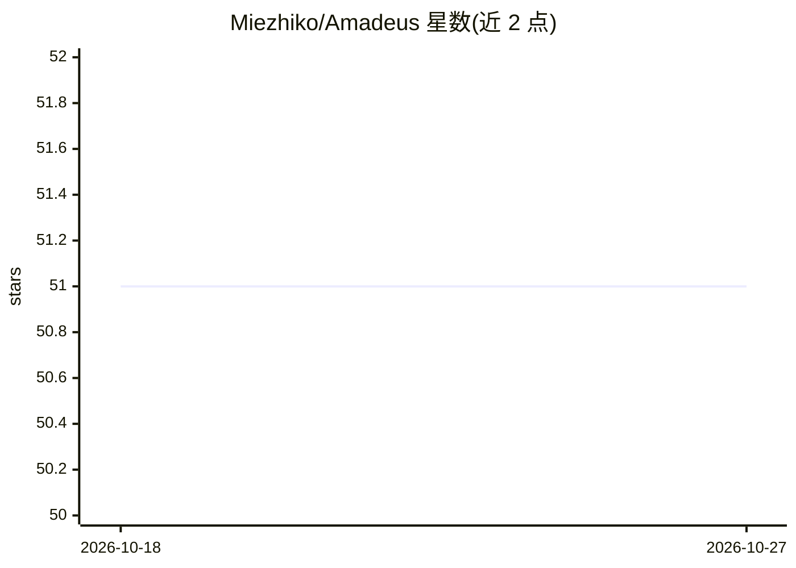

# Miezhiko/Amadeus

⭐ 51 · Rust · NOASSERTION · 推送 2026-05-30 · [GitHub](https://github.com/Miezhiko/Amadeus) · [官网](http://miezhiko.github.io) · 个人维护

**Discord 多功能聊天机器人，含 AI 翻译与魔兽3赛事追踪**

用 Rust 编写的 Discord 机器人，功能包括斜杠命令、基于 rust-bert 模型的自动翻译、Warcraft 3 战绩/新闻/直播追踪、录像解析、音乐播放（Songbird）、Twitch/GoodGame 多服务器直播通知、反垃圾与审核自动化、表情角色系统等。架构分为 Amadeus（Discord 服务）、Salieri（Celery/RabbitMQ 任务守护进程）、Strauss（PyTorch/tch-rs 任务集）。通过 cargo 编译构建，支持 systemd 服务部署，提供 dhall/YAML 配置与 Fluent 本地化。

## 筛选速览

| 维度 | 判定 | 备注 |
|---|---|---|
| AI 角色 | `ai-enhanced` | 去掉 AI 部分产品仍成立 |
| 许可风险 | `none` | NOASSERTION |
| 部署形态 | `library` | 以包/库形式分发 |
| 模型依赖 | — | README 未给出锁定关系 |
| 硬件要求 | — | 无带数字的原话,不猜 |
| 安装摩擦 | `medium` | 含编译或系统依赖之一 |
| 成熟度 | — | 结构信号不足 |

## 能力要点

- rust-bert 模型自动翻译（模型缓存至 RUSTBERT_CACHE）
- Warcraft 3 战绩统计、录像解析与 hostbot API 集成
- Celery/RabbitMQ 分布式任务队列架构
- 可选编译特性开关（trackers/flo/flotv/spam_filter 等）

## 适用场景

- 在 Discord 服务器里做 Warcraft 3 赛事追踪与战绩查询
- 多服务器直播通知与音乐播放
- 带自动翻译的聊天与审核自动化

## 场景标签

`聊天机器人` · 领域:对话与助手

## 证据(README 行号)

> L3:  Memory storage and artificial intelligence system.
> L32:  - Automatic translation with rust-bert models
> L108: Note: will lag at first run due pre-trained models downloading.

## 星数曲线

2026-10-18 51 → 2026-10-27 51（+0）

---
*卡片 v1 · prompt 1.4 · 生成 2026-10-24 · 置信度 low · 依据 README sha `24476e46be75` · [字段定义](../../DATASET.md)*
