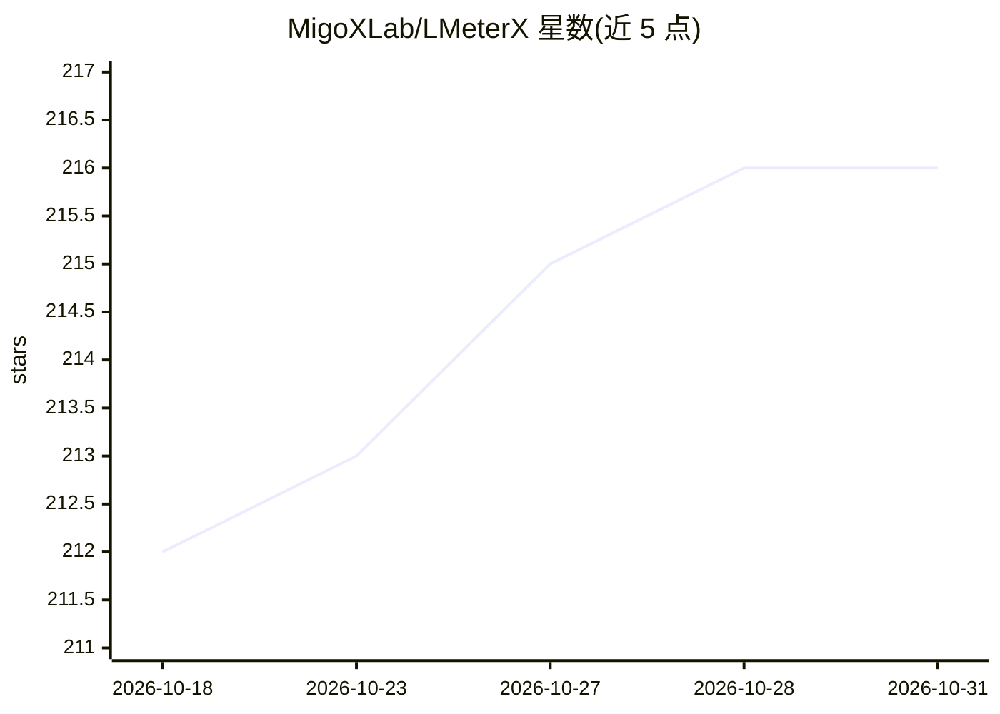

# MigoXLab/LMeterX

⭐ 216 · Python · Apache-2.0 · 推送 2026-09-22 · [GitHub](https://github.com/MigoXLab/LMeterX) · 组织维护 · 中文 README

**面向 LLM/HTTP/A2A/MCP 服务的通用 API 压测平台**

控制面与执行面分离的 Web 压测平台：控制面含前端、后端、MySQL 与 VictoriaMetrics，执行面为可注册的 Engine 集群。覆盖 vLLM、LiteLLM、TRT-LLM 等推理栈与 Azure OpenAI、AWS Bedrock 等云服务，原生支持 OpenAI、Anthropic、Embeddings 及自定义 API，并可对 A2A（JSON-RPC/REST/gRPC）与 MCP Streamable HTTP 服务施压。提供固定/阶梯并发、ShareGPT 公共数据集、TTFT/RPS/TPS 等指标、结果对比与 AI 分析报告，内置 MCP Server 支持 Claude Code、Cursor 等 agent 以自然语言发起压测。通过一键脚本与 Docker Compose 部署，支持 K8s 多集群调度与 LDAP/AD。

## 筛选速览

| 维度 | 判定 | 备注 |
|---|---|---|
| AI 角色 | `ai-ecosystem` | LLM/agent 周边工具 |
| 许可风险 | `permissive` | Apache-2.0 |
| 部署形态 | `self-host` | docker 或自建部署 |
| 模型依赖 | locked-api |  |
| 硬件要求 | — | 无带数字的原话,不猜 |
| 安装摩擦 | `low` | 无编译、无系统依赖或容器化 |
| 成熟度 | — | 结构信号不足 |

## 能力要点

- 覆盖 LLM、通用 HTTP、A2A（JSON-RPC/REST/gRPC）与 MCP 协议的负载测试
- 固定/阶梯并发策略与 TTFT、RPS、TPS 等多维度指标实时可视化
- 粘贴 curl 一键解析请求；Pref Insight 页多模型/多版本性能对比与 AI 分析报告
- 内置 MCP Server，Claude Code、Cursor 等 agent 可自然语言生成压测配置并启动任务

## 适用场景

- 给大模型推理服务或业务 HTTP 接口做并发压测并定位性能拐点
- 对比多个模型或多个版本在不同并发下的性能表现
- 对 A2A 协作服务与 MCP 工具调用服务做负载测试
- 通过 Claude Code/Cursor 等 agent 用自然语言发起压测任务

## 场景标签

 · 领域:LLM/服务性能测试基础设施

## 证据(README 行号)

> L14: LMeterX is a professional performance testing platform for LLM inference services, general HTTP APIs, and Agent pro
> L28: - **AI-Driven Data Insights**: AI-powered analysis reports &nbsp;NEW with multi-model comparison, intuitively ident
> L37: |Dimension|LMeterX|EvalScope|llmperf|

## 星数曲线

2026-10-18 212 → 2026-10-31 216（+4）

---
*卡片 v1 · prompt 1.4 · 生成 2026-10-22 · 置信度 high · 依据 README sha `16a77f406a84` · [字段定义](../../DATASET.md)*
