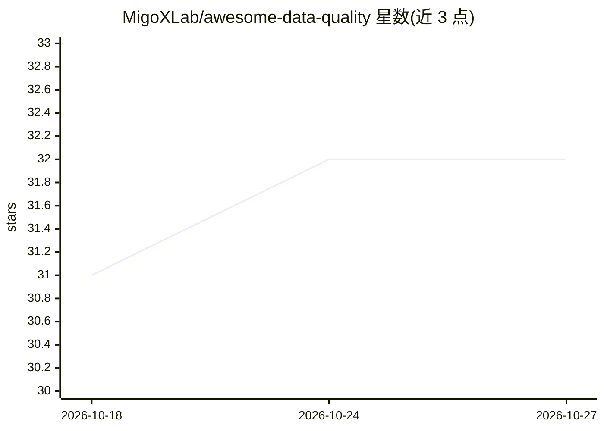

# MigoXLab/awesome-data-quality

⭐ 32 · CC0-1.0 · 推送 2026-10-23 · [GitHub](https://github.com/MigoXLab/awesome-data-quality) · 组织维护

**数据质量资源策展清单：覆盖传统/LLM/多模态等数据类型**

面向 data-centric AI 研究者与实践者的 awesome 清单，按传统数据、LLM 预训练/微调数据、多模态、表格、时间序列、图数据等类别组织，收录论文、工具与项目。LLM 部分包含预训练数据清洗工具（Dolma、CCNet）、微调数据平台（Argilla）、数据集（FineWeb、RedPajama）与推理数据资源。条目附年份与一句话描述，部分条目含商业产品与 CLI 工具。仓库本身不提供代码或安装方式。

## 筛选速览

| 维度 | 判定 | 备注 |
|---|---|---|
| AI 角色 | `ai-knowledge` | 知识聚合/清单类 |
| 许可风险 | `viral` | CC0-1.0 |
| 部署形态 | `None` |  |
| 模型依赖 | — | README 未给出锁定关系 |
| 硬件要求 | — | 无带数字的原话,不猜 |
| 安装摩擦 | `low` | 无编译、无系统依赖或容器化 |
| 成熟度 | — | 结构信号不足 |

## 能力要点

- 按 7+ 种数据类型分类组织条目
- 覆盖 LLM 预训练/微调/数据管理全链路资源
- 收录认知工程与测试时扩展方向的训练数据集

## 适用场景

- 为数据清洗与验证项目选型查找工具
- 了解 LLM 预训练数据质量领域的论文脉络
- 按数据类型（表格/时序/图）查找专用质量工具

## 场景标签

`精选清单` · 领域:学习与行业

## 证据(README 行号)

> L1: # Awesome Data Quality Awesome
> L3: Resources, tools, papers, and projects for ensuring data reliability and effectiveness across traditional data, LLM 

## 星数曲线

2026-10-18 31 → 2026-10-27 32（+1）

---
*卡片 v1 · prompt 1.4 · 生成 2026-10-26 · 置信度 high · 依据 README sha `12050d2d4311` · [字段定义](../../DATASET.md)*
