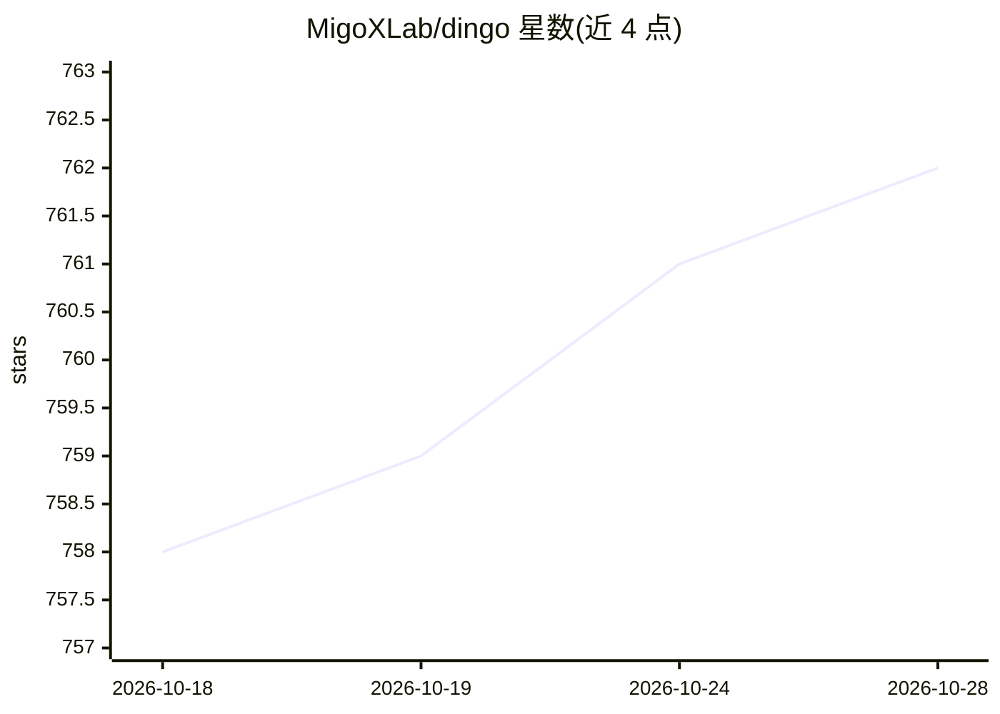

# MigoXLab/dingo

⭐ 763 · Python · Apache-2.0 · 推送 2026-10-27 · [GitHub](https://github.com/MigoXLab/dingo) · [官网](https://dingo.openxlab.org.cn/) · 组织维护 · 中文 README

**AI 数据/模型/应用质量评测工具：数据质量、幻觉检测、RAG 评估**

面向 ML 从业者、数据工程师与 AI 研究者的评测工具，覆盖预训练文本质量、SFT 数据 3H 检查、RAG 评估（基于 RAGAS/DeepEval/TruLens 研究的 5 项指标）、幻觉检测（HHEM-2.1-Open 等）与多模态质量，共 100+ 指标。评测方式混合 30+ 内置规则、LLM 深度评估（OpenAI/DeepSeek/Kimi/本地模型）与带工具的 Agent 评估。数据源支持本地文件、SQL 数据库（流式处理）、HuggingFace 与 S3；执行支持本地与 Spark 分布式；提供 Python SDK、CLI 与内置 MCP 服务器；另提供 SaaS 企业版（Web UI）。

## 筛选速览

| 维度 | 判定 | 备注 |
|---|---|---|
| AI 角色 | `ai-ecosystem` | LLM/agent 周边工具 |
| 许可风险 | `permissive` | Apache-2.0 |
| 部署形态 | `library` | 以包/库形式分发 |
| 模型依赖 | — | README 未给出锁定关系 |
| 硬件要求 | — | 无带数字的原话,不猜 |
| 安装摩擦 | `low` | 无编译、无系统依赖或容器化 |
| 成熟度 | — | 结构信号不足 |

## 能力要点

- 100+ 评测指标，含 RAG 5 项学术指标与 HHEM-2.1-Open 幻觉检测
- 规则 + LLM + Agent 三层混合评测，规则 30+ 内置且可注册自定义
- 多数据源接入：本地文件/PostgreSQL/MySQL/HuggingFace/S3，SQL 流式处理支持十亿级行
- 提供 Python SDK、CLI、MCP 服务器（dingo serve）三种接口，Spark 可扩展执行

## 适用场景

- 过滤 LLM 预训练与微调数据集中的低质量数据
- 评估 RAG 系统的检索与生成质量、检测幻觉
- 通过 MCP 在 Cursor 等 IDE 中调用数据质量检查
- 对生产数据库做字段级质量校验与报告

## 场景标签

`模型评测` · 领域:评测与运维

## 证据(README 行号)

> L38: **Dingo is A Comprehensive AI Data, Model and Application Quality Evaluation Tool**, designed for ML practitioners,
> L159: Dingo provides **100+ evaluation metrics** across multiple dimensions, combining rule-based speed with LLM-based d
> L269: **5 Academic-Backed Metrics** - Based on RAGAS, DeepEval, TruLens research

## 星数曲线

2026-10-18 758 → 2026-10-28 762（+4）

---
*卡片 v1 · prompt 1.4 · 生成 2026-10-22 · 置信度 high · 依据 README sha `190a5c8d90dc` · [字段定义](../../DATASET.md)*
