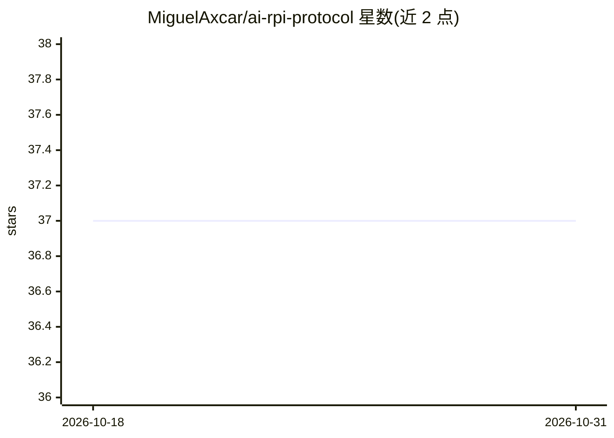

# MiguelAxcar/ai-rpi-protocol

⭐ 37 · MIT · 推送 2026-05-16 · [GitHub](https://github.com/MiguelAxcar/ai-rpi-protocol) · 个人维护

**约束 AI 编程代理工作流纪律的仓库内协议：先研究后编码**

以 AGENTS.md / CLAUDE.md 等入口文件形式放入任意仓库，为 Codex、Claude Code、GitHub Copilot agents、Cursor 等编码代理注入统一工作契约：先研究仓库再编码、质疑弱假设、按风险调节严谨度、完成前验证并按角色打包交付。内置 Mission Control 子代理协调层、PRD 驱动执行、确定性护栏与项目上下文记忆；自主执行默认关闭，需用户显式授权。不替代模型、IDE 或 CI，README 声明其不能完全控制代理行为。

## 筛选速览

| 维度 | 判定 | 备注 |
|---|---|---|
| AI 角色 | `ai-ecosystem` | LLM/agent 周边工具 |
| 许可风险 | `permissive` | MIT |
| 部署形态 | `None` |  |
| 模型依赖 | — | README 未给出锁定关系 |
| 硬件要求 | — | 无带数字的原话,不猜 |
| 安装摩擦 | `low` | 无编译、无系统依赖或容器化 |
| 成熟度 | — | 结构信号不足 |

## 能力要点

- Research → Plan → Implement 的分阶段纪律与自适应深度
- Mission Control 协调子代理进行研究、实现、验证与审查
- 通过 AGENTS.md / CLAUDE.md 薄适配器接入现有代理环境
- PRD 驱动执行配合 fresh-eyes 验证与确定性护栏

## 适用场景

- 让编码代理在动手前先读仓库、引用文件证据
- 生成带验证证据与关注点清单的可审阅 PR 审查
- 让小修保持小范围、大功能先暴露权衡再实现

## 场景标签

`提示工程` `代码审查` · 领域:Agent 开发

## 证据(README 行号)

> L9: AI-RPI is a portable, repo-native workflow for coding agents.
> L15: Works across modern coding-agent workflows, including Codex, Claude Code, GitHub Copilot agents, Cursor, and simila
> L163: - Thin adapters for repo-native entry surfaces such as `AGENTS.md` and `CLAUDE.md`

## 星数曲线

2026-10-18 37 → 2026-10-31 37（+0）

---
*卡片 v1 · prompt 1.4 · 生成 2026-10-25 · 置信度 high · 依据 README sha `1a38802425af` · [字段定义](../../DATASET.md)*
