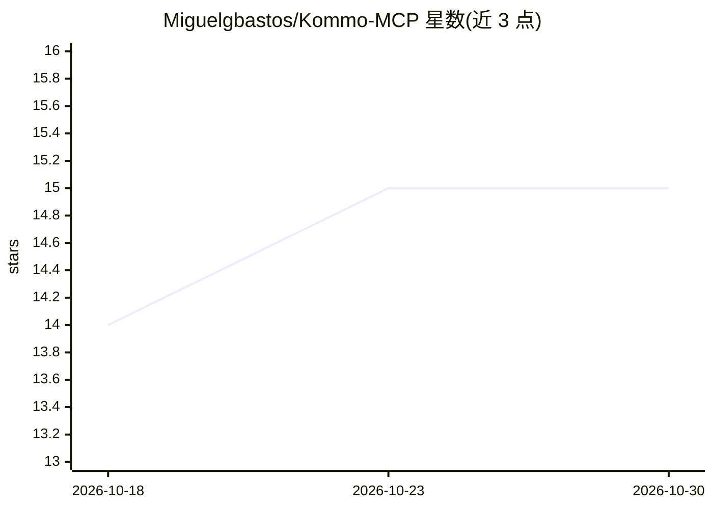

# Miguelgbastos/Kommo-MCP

⭐ 15 · TypeScript · MIT · 推送 2026-10-26 · [GitHub](https://github.com/Miguelgbastos/Kommo-MCP) · 个人维护

**将 Cursor、Claude 等 MCP 客户端接入 Kommo CRM 的服务器**

TypeScript 编写的 MCP (Model Context Protocol) 服务器，通过 23 个 tools、5 个 resources、4 个 prompts 将 Kommo CRM 的线索、联系人、公司、任务、管线、报表、Salesbot 等能力暴露给 MCP 客户端（Cursor、Claude Desktop 等），并提供自然语言问答工具 ask_kommo。支持 Streamable HTTP 与 stdio 两种传输；限流、Origin 校验、非 localhost 强制鉴权、写操作默认需 confirm。运行需 Node.js 22.13+ 与 Kommo 访问令牌，Docker 可选。npm 包尚未发布，v3 前需从源码构建。

## 筛选速览

| 维度 | 判定 | 备注 |
|---|---|---|
| AI 角色 | `ai-ecosystem` | LLM/agent 周边工具 |
| 许可风险 | `permissive` | MIT |
| 部署形态 | `self-host` | docker 或自建部署 |
| 模型依赖 | — | README 未给出锁定关系 |
| 硬件要求 | — | 无带数字的原话,不猜 |
| 安装摩擦 | `low` | 无编译、无系统依赖或容器化 |
| 成熟度 | — | 结构信号不足 |

## 能力要点

- 23 个 tools 覆盖线索/联系人/公司/任务/管线/报表/Salesbot 等 CRM 对象
- ask_kommo 自然语言问答工具
- Streamable HTTP 与 stdio 两种官方传输，兼容 MCP 2026-07-28 与 2025 stateless 客户端
- 写操作默认要求 confirm=true，非本地部署强制 MCP_AUTH_TOKEN 鉴权

## 适用场景

- 在 Cursor 或 Claude Desktop 中直接查询和操作 Kommo CRM 数据
- 让 AI 助手生成销售报表分析、管线表现分析
- 通过自然语言询问 CRM 中的业务数据（ask_kommo）

## 场景标签

 · 领域:CRM/AI 集成工具

## 证据(README 行号)

> L11: Servidor MCP (Model Context Protocol) para
> L13: Expõe **tools**, **resources** e **prompts** para clientes MCP (Cursor, Claude
> L322: |Cursor|stdio local ou HTTP|

## 星数曲线

2026-10-18 14 → 2026-10-30 15（+1）

---
*卡片 v1 · prompt 1.4 · 生成 2026-10-30 · 置信度 high · 依据 README sha `f135645312ba` · [字段定义](../../DATASET.md)*
