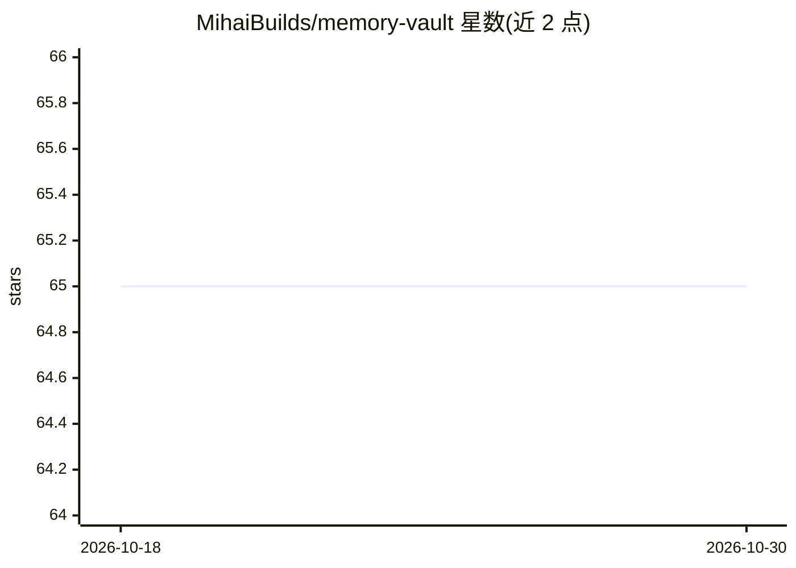

# MihaiBuilds/memory-vault

⭐ 65 · Python · MIT · 推送 2026-10-28 · [GitHub](https://github.com/MihaiBuilds/memory-vault) · [官网](https://mihaibuilds.com) · 个人维护

**给 AI 应用提供自托管持久记忆层的数据库系统**

自托管的 AI 记忆存储：基于 PostgreSQL 16 + pgvector 的单库方案，向量化、全文索引与关系数据共存。提供混合检索（语义+关键词+RRF）、MCP 工具（recall/remember 等 6 个）、REST API、CLI 与 Web 仪表盘；用 sentence-transformers 做嵌入、spaCy 做实体抽取构成知识图谱，均 CPU 运行。面向开发者，可接入 Claude Desktop/Claude Code，或经 LM Studio 本地模型对话，回答附带来源片段。默认 MCP 走 stdio，HTTP/SSE 远程访问需显式开启并配 token，传输层不加密需自加 TLS。

## 筛选速览

| 维度 | 判定 | 备注 |
|---|---|---|
| AI 角色 | `ai-ecosystem` | LLM/agent 周边工具 |
| 许可风险 | `permissive` | MIT |
| 部署形态 | `self-host` | docker 或自建部署 |
| 模型依赖 | locked-api |  |
| 硬件要求 | `cpu-ok` | |
| 安装摩擦 | `low` | 无编译、无系统依赖或容器化 |
| 成熟度 | — | 结构信号不足 |

## 能力要点

- Postgres + pgvector 单库承载向量、全文与关系数据，无独立向量库
- MCP 六工具（recall/remember/forget/purge 等）供 Claude 会话中读写记忆
- 本地 LLM 对话（LM Studio），每个回答附来源片段与相似度
- 知识图谱由 spaCy 实体抽取自动构建，全程 CPU 运行

## 适用场景

- 让 Claude 在任何会话中记住并召回项目决策与笔记
- 为自己的 AI 应用通过 REST API 接入持久记忆层
- 本地无云端地对自有记忆做带来源的问答

## 场景标签

`Agent 记忆` `知识图谱` `语义搜索` · 领域:Agent 开发

## 证据(README 行号)

> L11: **The memory database for AI applications.** Self-hosted Postgres + pgvector with hybrid search, MCP-native, and a 
> L15: Memory Vault is the persistent layer underneath. It stores what you want your AI to remember — decisions, conversat
> L96: - **MCP integration** — four tools (`recall`, `remember`, `forget`, `memory_status`) that Claude can use natively d

## 星数曲线

2026-10-18 65 → 2026-10-30 65（+0）

---
*卡片 v1 · prompt 1.4 · 生成 2026-10-24 · 置信度 mid · 依据 README sha `3274d027c3e3` · [字段定义](../../DATASET.md)*
