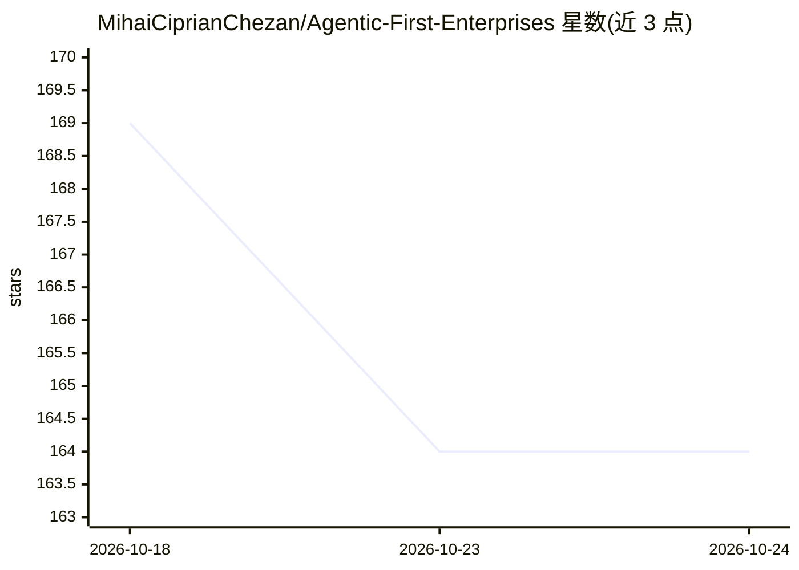

# MihaiCiprianChezan/Agentic-First-Enterprises

⭐ 164 · CC-BY-4.0 · 推送 2026-09-12 · [GitHub](https://github.com/MihaiCiprianChezan/Agentic-First-Enterprises) · 个人维护

**Agent 优先企业的组织运营参考模型文档**

一份面向组织的运营模型规范文档，而非软件：定义任何角色可由人类、agent 或确定性程序互换填充（角色多态）、流程以 agent 优先构建、且每个流程可被人类暂停调整后继续（普遍可中断）。给出 11 条设计不变量（INV-1~11）、角色契约字段结构、由人类担任的问责层（Board）与双通道干预规则。适用于运营、服务、研究、制造协调等场景；自带规范化语言与成熟度声明，§16 联邦层仍处设计阶段。

## 筛选速览

| 维度 | 判定 | 备注 |
|---|---|---|
| AI 角色 | `ai-knowledge` | 知识聚合/清单类 |
| 许可风险 | `viral` | CC-BY-4.0 |
| 部署形态 | `None` |  |
| 模型依赖 | — | README 未给出锁定关系 |
| 硬件要求 | — | 无带数字的原话,不猜 |
| 安装摩擦 | `low` | 无编译、无系统依赖或容器化 |
| 成熟度 | `idea` | |

## 能力要点

- 11 条设计不变量与 4 条 handbrake（HB-1~4）规范要求
- 角色即契约：人/agent/程序作为可互换实现者
- 人类以宪法制定与角色顶替两条通道介入组织
- 以自治 cell 为单元，可组合为联邦（§16，设计阶段）

## 适用场景

- 设计人机混编组织结构与问责边界
- 为 agent 流程建立可中断、可审计的治理规范
- 参考角色契约模板定义可替换的工作角色

## 场景标签

 · 领域:企业组织架构/多智能体治理

## 证据(README 行号)

> L7: **A reference operating model for organizations built on three rules. An agent or a human can fill any role. Every p
> L11: This is a generic model. Software delivery was its inspiration, but the model is not specific to software. The same
> L50: These are the non-negotiable rules. The document cites them as INV-1 to INV-11. Everything below is a consequence o

## 星数曲线

2026-10-18 169 → 2026-10-24 164（-5）

---
*卡片 v1 · prompt 1.4 · 生成 2026-10-23 · 置信度 high · 依据 README sha `9378f3af700d` · [字段定义](../../DATASET.md)*
