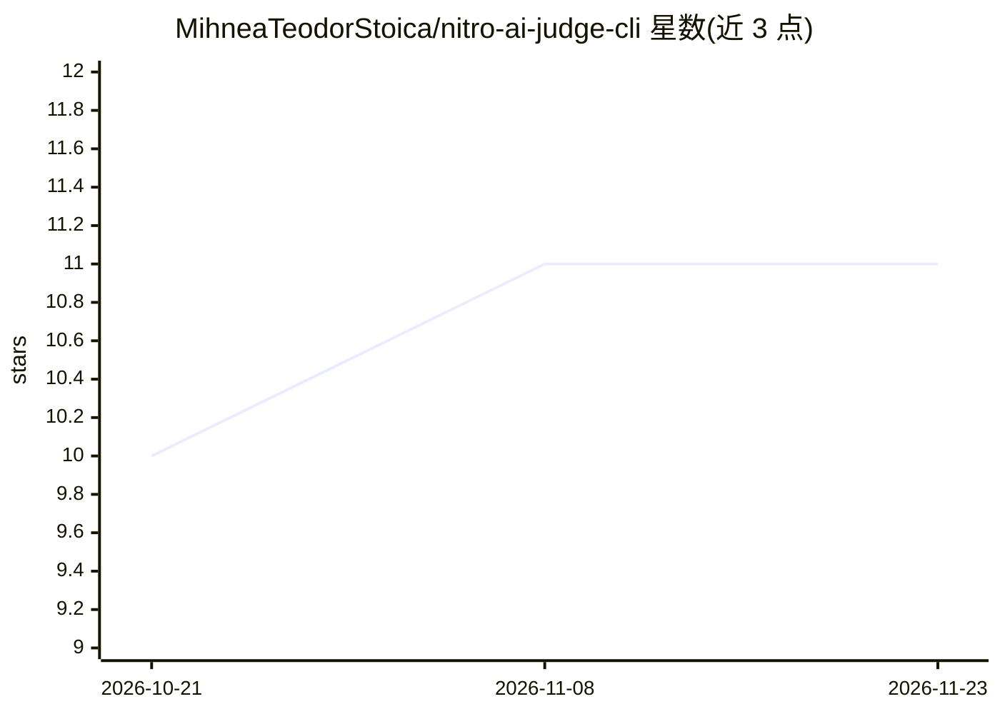

# MihneaTeodorStoica/nitro-ai-judge-cli

⭐ 11 · Python · MIT · 推送 2026-10-20 · [GitHub](https://github.com/MihneaTeodorStoica/nitro-ai-judge-cli) · [官网](https://pypi.org/project/nitro-ai-judge-cli/) · 个人维护

**Nitro AI Judge 竞赛平台的 CLI/TUI 客户端**

面向 judge.nitro-ai.org 的 Python 命令行客户端 `naij`：浏览竞赛与任务、下载任务数据（statement/train_data 等 5 类）、提交解答并等待评审反馈、管理提交列表，并通过容器化的 Play manager 在本地用 Docker/Podman+Compose 复跑历史竞赛（Jupyter 环境）。提供 Textual 全屏 TUI（键盘优先，含缓存离线浏览、token 自动刷新），支持 PyPI/AUR/源码安装，API 端点与提交代理可配置。Play 功能需容器运行时，核心 CLI 不依赖。

## 筛选速览

| 维度 | 判定 | 备注 |
|---|---|---|
| AI 角色 | `ai-ecosystem` | LLM/agent 周边工具 |
| 许可风险 | `permissive` | MIT |
| 部署形态 | `desktop` | 安装包/桌面程序 |
| 模型依赖 | — | README 未给出锁定关系 |
| 硬件要求 | — | 无带数字的原话,不猜 |
| 安装摩擦 | `low` | 无编译、无系统依赖或容器化 |
| 成熟度 | — | 结构信号不足 |

## 能力要点

- CLI 与 Textual TUI 双形态：Yazi 风格浏览器、四视图任务面板、完整键盘操作
- 容器化 Play manager 本地复跑历史竞赛，端口私有化、日志脱敏、操作可取消
- 本地缓存与 --offline 离线浏览，凭据刷新与失败恢复流程
- 可配置 API 端点与提交代理（--api-url/PROXY_URL 等优先级链）

## 适用场景

- 参加 Nitro AI Judge 竞赛时下载任务数据并提交解答
- 在本地容器中复跑过去的竞赛任务
- 用 TUI 集中管理竞赛、任务与提交记录

## 场景标签

 · 领域:机器学习竞赛/开发者工具

## 证据(README 行号)

> L5: `naij` is a command-line client for `judge.nitro-ai.org`. It can browse competitions and tasks, download task data, 
> L257: Version 3 routes every competition operation through one Dockerized Play

## 星数曲线

2026-10-21 10 → 2026-11-23 11（+1）

---
*卡片 v1 · prompt 1.4 · 生成 2026-11-19 · 置信度 high · 依据 README sha `2a4758d620dd` · [字段定义](../../DATASET.md)*
