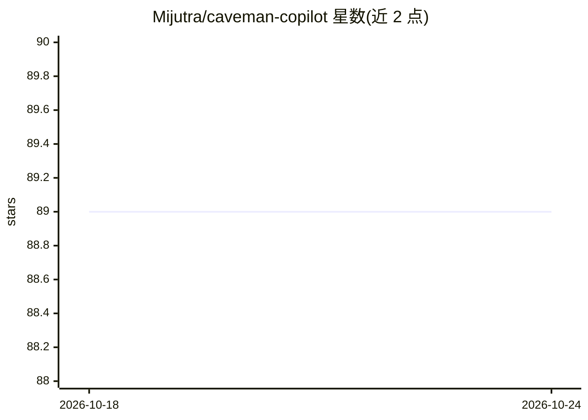

# Mijutra/caveman-copilot

⭐ 89 · Makefile · MIT · 推送 2026-05-27 · [GitHub](https://github.com/Mijutra/caveman-copilot) · 个人维护

**给 GitHub Copilot 用的 Caveman 风格提示词文件：复制即用无需安装**

原 caveman 项目（Claude Code/Codex 插件，以穴居人语气削减约 75% 输出 token）的轻量提示词文件打包：仓库仅含 caveman.prompt.md（VS Code 斜杠命令）与 caveman.instructions.md（always-on 模式）两个 Markdown 文件及安装指南。使用方式为下载/克隆后复制到 .github/prompts 或 VS Code 全局 prompts 目录，支持 lite/full/ultra 三档与 Wenyan 模式（上游描述）。JetBrains 等其他 IDE 需手动将提示词粘贴到 Copilot custom instructions。

## 筛选速览

| 维度 | 判定 | 备注 |
|---|---|---|
| AI 角色 | `ai-ecosystem` | LLM/agent 周边工具 |
| 许可风险 | `permissive` | MIT |
| 部署形态 | `None` |  |
| 模型依赖 | — | README 未给出锁定关系 |
| 硬件要求 | — | 无带数字的原话,不猜 |
| 安装摩擦 | `medium` | 含编译或系统依赖之一 |
| 成熟度 | — | 结构信号不足 |

## 能力要点

- 两个提示词文件：斜杠命令版与 always-on 指令版
- 提供 Makefile 快捷命令（make install-global / install-repo）复制文件
- 支持 lite/full/ultra 三档输出级别，'normal mode' 关闭
- 跨 IDE 使用说明（VS Code 原生支持，JetBrains 等走 custom instructions）

## 适用场景

- 在 GitHub Copilot 中用 /caveman 命令减少输出 token
- 让 Copilot 每次新会话自动进入 caveman 模式
- 不想通过 NPM 安装原插件、只要一个提示词文件的用户

## 场景标签

`提示工程` · 领域:Agent 开发

## 证据(README 行号)

> L11: This repo keeps it simple: grab `.github/prompts/caveman.prompt.md`, drop it where your editor expects it, and use 
> L22: - `.github/prompts/caveman.prompt.md`
> L245: Upstream project good. For GitHub Copilot prompt-file workflow, many people only need one Markdown file, not full 

## 星数曲线

2026-10-18 89 → 2026-10-24 89（+0）

---
*卡片 v1 · prompt 1.4 · 生成 2026-10-23 · 置信度 mid · 依据 README sha `0dd578f8a90a` · [字段定义](../../DATASET.md)*
