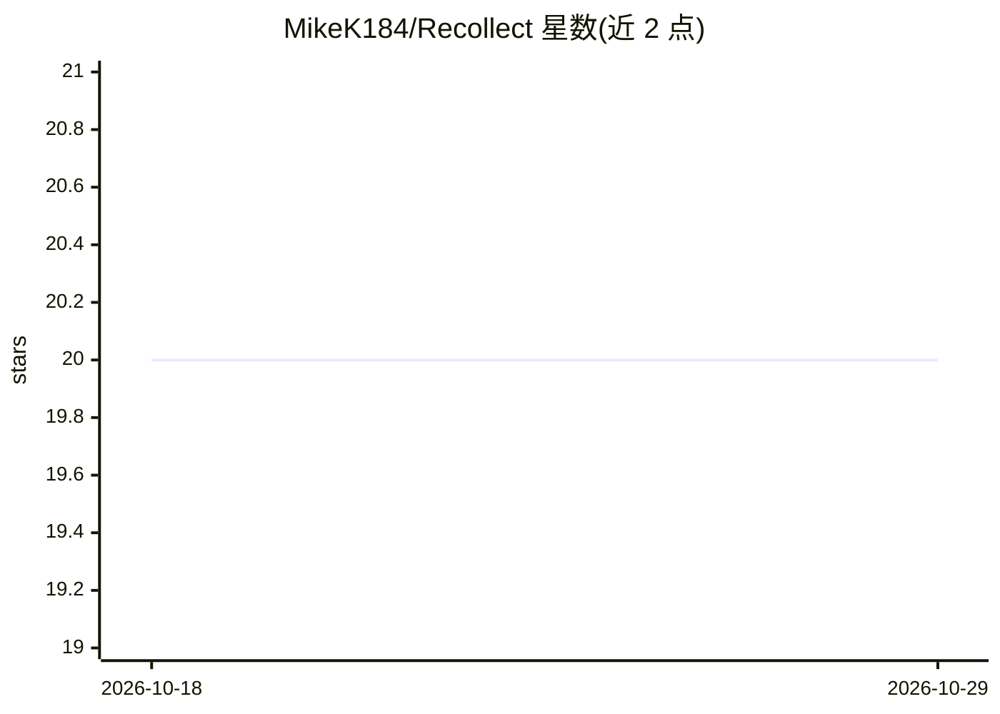

# MikeK184/Recollect

⭐ 20 · Rust · Apache-2.0 · 推送 2026-10-20 · [GitHub](https://github.com/MikeK184/Recollect) · [官网](https://recollecthub.com) · 个人维护

**自托管的编码 agent 记忆与 MCP 协调系统**

面向 Codex、Claude Code 和 OpenCode 的自托管服务：以 Brain 为单位保存跨仓库、跨会话的决策、调查与交接记录，会话结束前经捕获-学习-回忆循环将带引用的上下文注入下次提示；支持动态技能同步、基于权限组的 MCP 工具治理与私网 runner 执行。技术栈为 Rust API/worker、PostgreSQL+pgvector、Neo4j，通过 Docker Compose 部署，附 React 桌面 Web UI。语义学习与检索需配置 OPENAI_API_KEY，模型调用由提供商计费；项目自述为早期阶段。

## 筛选速览

| 维度 | 判定 | 备注 |
|---|---|---|
| AI 角色 | `ai-ecosystem` | LLM/agent 周边工具 |
| 许可风险 | `permissive` | Apache-2.0 |
| 部署形态 | `self-host` | docker 或自建部署 |
| 模型依赖 | — | README 未给出锁定关系 |
| 硬件要求 | — | 无带数字的原话,不猜 |
| 安装摩擦 | `low` | 无编译、无系统依赖或容器化 |
| 成熟度 | `idea` | |

## 能力要点

- 捕获-学习-回忆循环，带引用的跨会话记忆（精确/关键词/语义/图检索，8 KiB 预算）
- 技能与共享指令（SKILL.md/AGENTS.md）一次发布、多主机原生同步
- MCP 工具按 Use/Manage/Share 权限组治理，可经私网 runner 出站执行
- 一个 Docker Compose 栈自托管，捕获/保留/模型策略可自定

## 适用场景

- 让接手的编码 agent 会话直接获得此前的决策与修复上下文
- 团队在多台主机间同步共享技能与指令
- 对 agent 可调用的 MCP 工具做集中授权与私网内执行
- 多机器上的 agent 会话互相通报工作范围避免冲突

## 场景标签

`Agent 记忆` `知识图谱` · 领域:Agent 开发

## 证据(README 行号)

> L20: **Recollect is a self-hosted Brain for your coding agents.** When a Codex, Claude
> L92: A **Brain** holds the knowledge, skills, tool connections and access rules for a
> L149: The plugin and direct MCP clients reach the same scoped tools at

## 星数曲线

2026-10-18 20 → 2026-10-29 20（+0）

---
*卡片 v1 · prompt 1.4 · 生成 2026-10-28 · 置信度 high · 依据 README sha `02918e94af61` · [字段定义](../../DATASET.md)*
