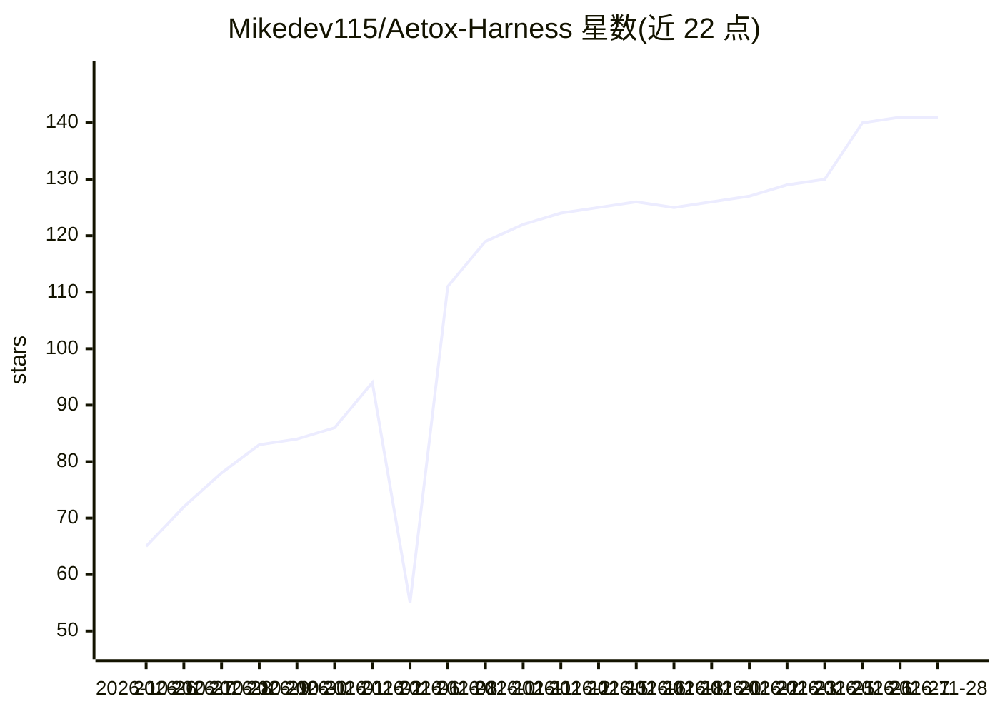

# Mikedev115/Aetox-Harness

⭐ 141 · Go · NOASSERTION · 推送 2026-11-27 · [GitHub](https://github.com/Mikedev115/Aetox-Harness) · [官网](https://mikedev115.github.io/Aetox-landing/) · 个人维护 · 中文 README

**让 AI agent 在本机真实终端/浏览器/项目中完成任务的桌面环境**

Aetox harness 是一个桌面 agent 环境：连接模型后，用户交给它任务，它在真实终端、浏览器与项目文件中分步执行——读取项目、制定计划、编辑文件、运行测试、自检结果后交付文档或代码。上下文架构将记忆与技能按节点索引，仅在任务使用时加载完整内容；本地数据留在用户机器上。安装渠道包括 Microsoft Store、Windows 安装包与 Scoop/Linux；模型自选，支持 ChatGPT、GitHub Copilot、OpenRouter 登录或接入 LM Studio/Ollama 本地运行。

## 筛选速览

| 维度 | 判定 | 备注 |
|---|---|---|
| AI 角色 | `ai-native` | 本体是模型或模型工具 |
| 许可风险 | `none` | NOASSERTION |
| 部署形态 | `desktop` | 安装包/桌面程序 |
| 模型依赖 | local-ok | 支持本地模型 |
| 硬件要求 | — | 无带数字的原话,不猜 |
| 安装摩擦 | `low` | 无编译、无系统依赖或容器化 |
| 成熟度 | — | 结构信号不足 |

## 能力要点

- 真实终端与浏览器执行，运行项目自身测试后再报告完成
- 上下文按节点索引，工具与技能以名称占用上下文，专用工具仅在调用时加载
- 49 个技能与 37 个 /commands，152 个 MCP 服务器可扩展
- 按语言页面标准（TH Sarabun New、GB/T 9704-2012 等）生成并打印校验文档

## 适用场景

- 让 agent 读取项目并完成带测试验证的编码任务
- 会议录音转录并生成带时间戳的纪要文件
- 按各国公文标准生成报价单/函件/报告并打印
- 在已有 Excel 工作簿上做公式与格式的增量修改

## 场景标签

`GUI 自动化` `AI 助手` `编码 Agent` `OCR` · 领域:效率与自动化

## 证据(README 行号)

> L7: Aetox harness is the environment that lets AI actually work on your computer — it reads the project, plans, then wor
> L43: **The system makes the model write better code** — that is the only thing we sell for code, not the model's own
> L77: 2. **Connect a model.** Open **Settings › Models** and sign in with ChatGPT, GitHub Copilot or OpenRouter, or paste

## 星数曲线

2026-10-26 65 → 2026-11-28 141（+76）

---
*卡片 v1 · prompt 1.4 · 生成 2026-11-27 · 置信度 high · 依据 README sha `65391601e648` · [字段定义](../../DATASET.md)*
