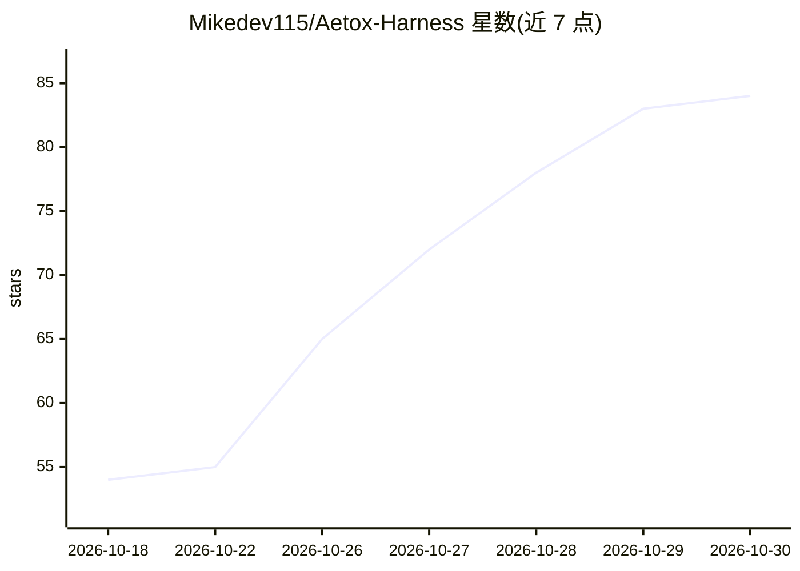

# Mikedev115/Aetox-Harness

⭐ 84 · Go · NOASSERTION · 推送 2026-10-29 · [GitHub](https://github.com/Mikedev115/Aetox-Harness) · [官网](https://mikedev115.github.io/Aetox-landing/) · 个人维护

**Windows 本地优先 AI agent 客户端，接入 31 家模型操作文件/代码/浏览器**

面向 Windows 10+ x64 的免费桌面 AI agent（非开源）：用户自带模型或使用本地模型，Aetox 提供文件、浏览器、终端等工具层，让模型处理编码、文档（Excel/Word/PowerPoint）、视频剪辑等任务，并以'团队'模式拆分多 agent 工作。支持 31 家 provider（OpenAI/Anthropic/Gemini/Ollama 等），含权限分级与密钥本地存储。限制：非开源、后版本仅二进制分发、未代码签名安装器、token 用量较高。

## 筛选速览

| 维度 | 判定 | 备注 |
|---|---|---|
| AI 角色 | `ai-native` | 本体是模型或模型工具 |
| 许可风险 | `none` | NOASSERTION |
| 部署形态 | `desktop` | 安装包/桌面程序 |
| 模型依赖 | local-ok | 支持本地模型 |
| 硬件要求 | — | 无带数字的原话,不猜 |
| 安装摩擦 | `low` | 无编译、无系统依赖或容器化 |
| 成熟度 | — | 结构信号不足 |

## 能力要点

- 接入 31 家 provider，含 OpenRouter 登录与 Ollama/LM Studio 本地服务
- Code/Assistant/Teams/Studio 多模式：编码、文档生成、视频剪辑
- 数据留在本机，密钥绑定 Windows 账户，权限三级分级
- 通过 Microsoft Store、winget、安装器、Scoop 多渠道安装

## 适用场景

- 用自有模型在本地完成编码与项目修改
- 让 AI 处理会议记录、收据并产出 Excel/Word/PowerPoint 文件
- 把整项工作交给多 agent 团队并追踪各环节产出

## 场景标签

`多智能体` `编码 Agent` `AI 助手` · 领域:Agent 开发

## 证据(README 行号)

> L9:  Say what you want. Aetox lines up the team and the tools, and hands back finished work.
> L62:  a key, or point it at LM Studio or Ollama on your machine.
> L112: 31 providers, cloud and local. ChatGPT (Codex), GitHub Copilot and OpenRouter sign in; the rest take an API key or

## 星数曲线

2026-10-18 54 → 2026-10-30 84（+30）

---
*卡片 v1 · prompt 1.4 · 生成 2026-10-24 · 置信度 high · 依据 README sha `8ef013a82023` · [字段定义](../../DATASET.md)*
