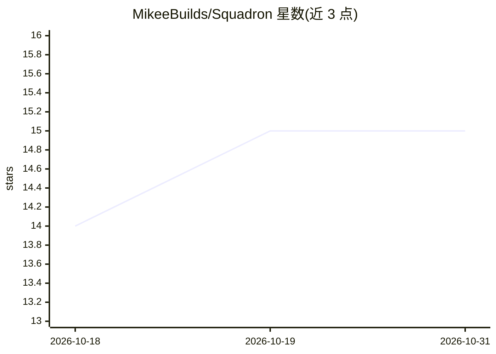

# MikeeBuilds/Squadron

⭐ 15 · TypeScript · NOASSERTION · 推送 2025-12-24 · [GitHub](https://github.com/MikeeBuilds/Squadron) · 个人维护

**桌面端多 AI 编码代理指挥中心：并行运行与管理本地 agent**

Electron 混合架构的桌面应用，用于管理多个本地 AI 编码代理（Claude、Gemini、Codex、OpenCode、Cursor），将其类比为员工进行调度。核心机制包括 3x2 六终端并行工作台、Kanban 任务看板（Backlog→Done 五列、SSE 实时更新）、Git worktree 任务隔离并行执行、API 密钥 OS 级加密本地存储。集成 Jira、Linear、Slack、Discord、GitHub 等 11 项。目前仅提供 Windows 安装包，macOS/Linux 标注 Coming Soon；CLI 选中 provider 时自动下载。

## 筛选速览

| 维度 | 判定 | 备注 |
|---|---|---|
| AI 角色 | `ai-ecosystem` | LLM/agent 周边工具 |
| 许可风险 | `none` | NOASSERTION |
| 部署形态 | `desktop` | 安装包/桌面程序 |
| 模型依赖 | locked-api |  |
| 硬件要求 | — | 无带数字的原话,不猜 |
| 安装摩擦 | `low` | 无编译、无系统依赖或容器化 |
| 成熟度 | — | 结构信号不足 |

## 能力要点

- 六终端网格并行运行多个 AI 编码代理，每终端可独立选 provider
- Git worktree 隔离：每任务独立工作区与分支，可合并或丢弃
- Kanban 看板任务管理与终端任务关联、上下文注入
- API 密钥加密本地存储（Windows DPAPI / macOS Keychain）

## 适用场景

- 同时运行多个 AI 编码代理并行处理开发任务
- 用看板管理 AI 代理的任务分配与进度
- 通过 Git worktree 让多代理并行工作且主分支受保护

## 场景标签

`编码 Agent` `多智能体` · 领域:Agent 开发

## 证据(README 行号)

> L9:  Squadron is a native command center that lets you manage swarms of local AI agents (Gemini, Claude, Codex) as if th
> L31: |**🤖 Multi-Provider Support**|Claude, Gemini, Codex, OpenCode, Cursor|
> L54: Run any AI coding assistant directly in Squadron:

## 星数曲线

2026-10-18 14 → 2026-10-31 15（+1）

---
*卡片 v1 · prompt 1.4 · 生成 2026-10-30 · 置信度 high · 依据 README sha `a6c56eefe151` · [字段定义](../../DATASET.md)*
