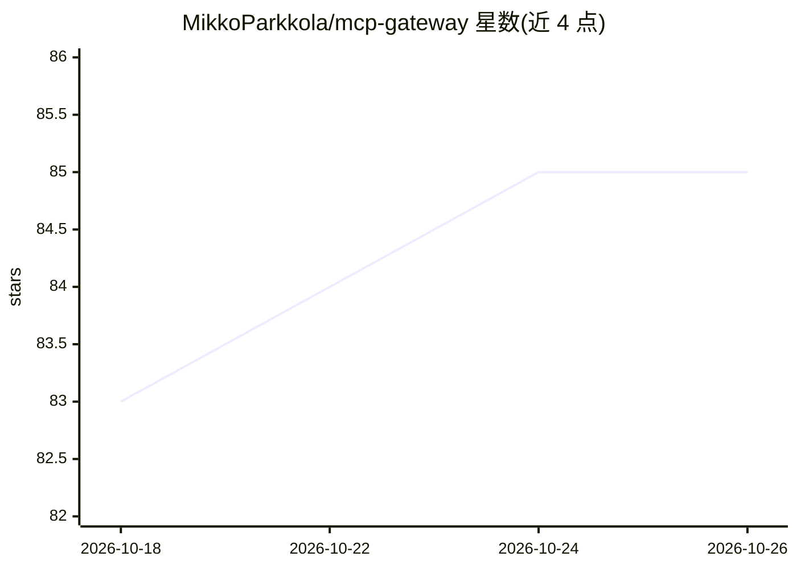

# MikkoParkkola/mcp-gateway

⭐ 85 · Rust · NOASSERTION · 推送 2026-10-25 · [GitHub](https://github.com/MikkoParkkola/mcp-gateway) · [官网](https://crates.io/crates/mcp-gateway) · 个人维护

**自托管 MCP 网关：把大量 MCP 服务器与 API 聚合到少量工具面**

单个 Rust 二进制的 MCP 网关与代理：部署在 AI 客户端与后端工具之间，代理仅暴露 9-17 个固定元工具（如 gateway_search_tools / gateway_invoke），按需发现并调用后端 MCP 服务器与 REST API 工具，以降低工具定义占用的上下文；README 注明额外检索跳转会增加 token 与回合开销，价值在目录容量与策略路由。支持 110+ 内置能力、OpenAPI 导入、工具投毒校验、mTLS、热重载与断路器等。面向需要接入大量 MCP 工具的 agent 使用者，个人与非商业用途免费，商业使用需商业许可。

## 筛选速览

| 维度 | 判定 | 备注 |
|---|---|---|
| AI 角色 | `ai-ecosystem` | LLM/agent 周边工具 |
| 许可风险 | `none` | NOASSERTION |
| 部署形态 | `desktop` | 安装包/桌面程序 |
| 模型依赖 | — | README 未给出锁定关系 |
| 硬件要求 | — | 无带数字的原话,不猜 |
| 安装摩擦 | `low` | 无编译、无系统依赖或容器化 |
| 成熟度 | — | 结构信号不足 |

## 能力要点

- 聚合多后端为 9-17 个固定元工具的 MCP 网关/代理
- 110+ 内置能力，可导入 OpenAPI spec 接入 REST API
- 工具投毒描述校验、SHA-256 能力锁定、mTLS 与消息签名
- 约 8ms 热重载后端与配置，断路器/限流/健康检查

## 适用场景

- 我在用多个 MCP 客户端时统一管理和路由所有 MCP 服务器
- 工具太多撑爆上下文，需要按需发现而非全量加载
- 把内部 REST API 通过 OpenAPI 导入给 agent 使用
- 对后端工具做安全校验与按用户身份传递

## 场景标签

`模型网关` · 领域:Agent 开发

## 证据(README 行号)

> L20: MCP Gateway is a single Rust binary that sits between an AI client and all of its tools. Connect MCP servers and RE
> L190: MCP Gateway is a tool and capability **router**. It routes MCP tool, resource, and prompt traffic to backend MCP s

## 星数曲线

2026-10-18 83 → 2026-10-26 85（+2）

---
*卡片 v1 · prompt 1.4 · 生成 2026-10-24 · 置信度 mid · 依据 README sha `3eec54498a85` · [字段定义](../../DATASET.md)*
