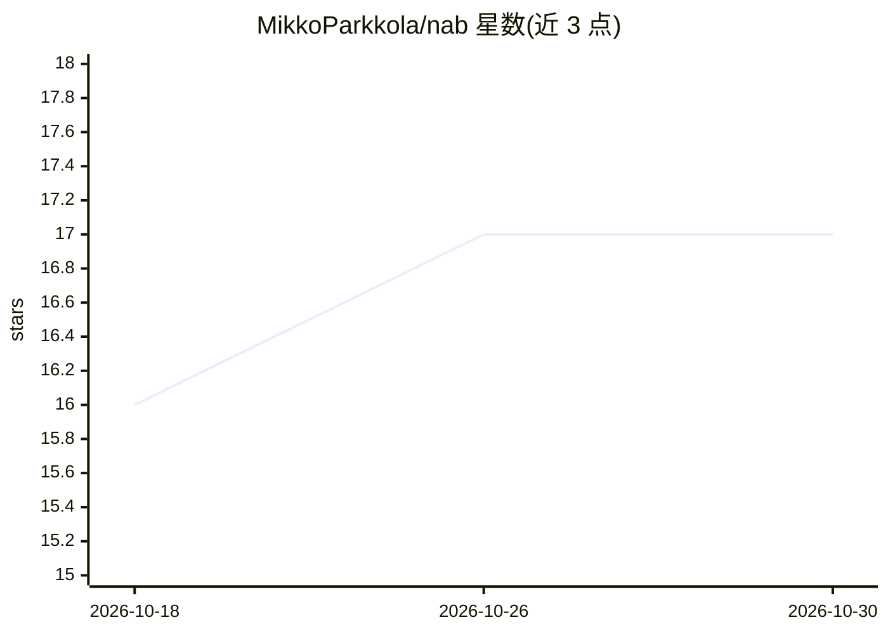

# MikkoParkkola/nab

⭐ 17 · Rust · MIT · 推送 2026-10-26 · [GitHub](https://github.com/MikkoParkkola/nab) · [官网](https://crates.io/crates/nab) · 个人维护

**面向 LLM agent 的本地网页抓取/ASR 工具：URL 转干净 markdown**

单个 Rust 二进制，提供三项能力：将任意 URL 抓取并转换为面向 LLM 上下文的干净 markdown（支持真实浏览器 Cookie、1Password 自动登录、WebAuthn passkey、指纹伪装与 WAF 绕过）；本地多语言 ASR 与说话人分离（FluidAudio/Parakeet TDT、sherpa-onnx、whisper 后端）；URL 变更监控并经 MCP resources 推送。默认开启针对 prompt injection 的双重防护（隐藏指令检测与 YARA-X 签名扫描）。以 CLI 与 MCP 服务器形式提供，可接入 Claude Code、Cursor、Windsurf 等 MCP 客户端。限制：安全防护模块为 PolyForm 非商业许可，商业使用需商业授权；OCR 仅限 macOS Apple Vision。

## 筛选速览

| 维度 | 判定 | 备注 |
|---|---|---|
| AI 角色 | `ai-ecosystem` | LLM/agent 周边工具 |
| 许可风险 | `permissive` | MIT |
| 部署形态 | `desktop` | 安装包/桌面程序 |
| 模型依赖 | — | README 未给出锁定关系 |
| 硬件要求 | — | 无带数字的原话,不猜 |
| 安装摩擦 | `medium` | 含编译或系统依赖之一 |
| 成熟度 | — | 结构信号不足 |

## 能力要点

- 任意 URL → 干净 markdown，Cookie 注入与反爬绕过，输出按 token 预算裁剪
- 本地多语言 ASR + 说话人分离（131x 实时率，Apple Neural Engine）
- 默认开启 prompt-injection 防护：隐藏指令检测 + YARA-X 签名扫描
- MCP 2025-11-25 / 2026-07-28 服务器，stdio + Streamable HTTP，12 个工具

## 适用场景

- 让 AI agent 以低 token 成本抓取网页并保留登录态访问内部系统
- 本地转录与说话人分离音视频文件，不依赖云端 API
- 监控网页变更并推送给 MCP 客户端
- 拦截网页中隐藏的 prompt injection 指令

## 场景标签

`网页抓取` `语音识别` · 领域:效率与自动化

## 证据(README 行号)

> L18: nab is a single Rust binary that does three things very well: it **fetches** any URL as clean markdown (with your r
> L58: |`nab-mcp`|MCP 2025-11-25 and 2026-07-28 server. stdio + Streamable HTTP. 12 tools, 4 prompts, 2+N resources, struc
> L36: Your agent will install the binary, wire itself up, and start fetching. Works in Claude Code, Cursor, Windsurf, and

## 星数曲线

2026-10-18 16 → 2026-10-30 17（+1）

---
*卡片 v1 · prompt 1.4 · 生成 2026-10-30 · 置信度 high · 依据 README sha `ef00d824bd32` · [字段定义](../../DATASET.md)*
