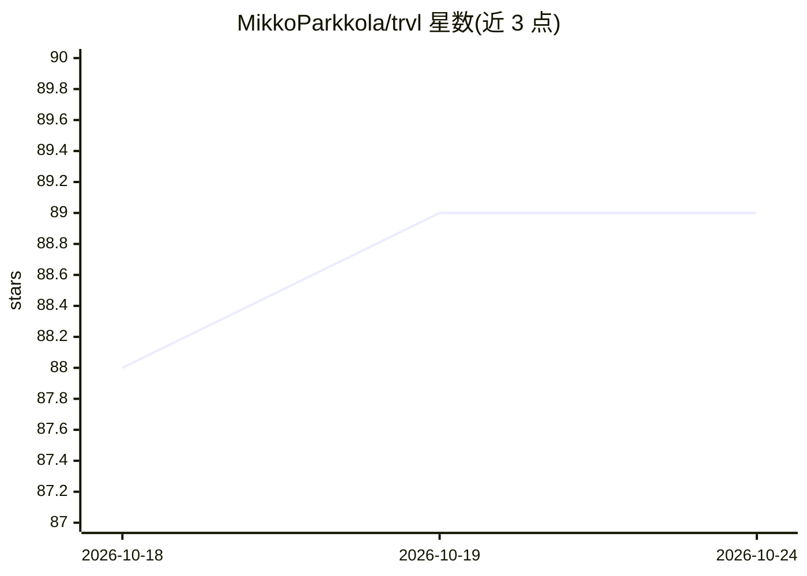

# MikkoParkkola/trvl

⭐ 89 · Go · NOASSERTION · 推送 2026-10-23 · [GitHub](https://github.com/MikkoParkkola/trvl) · [官网](https://mikkoparkkola.github.io/trvl/) · 个人维护

**给 AI 助手的旅行搜索 MCP 服务器：机票酒店火车一体的单一二进制**

单文件 Go 二进制，作为 MCP 服务器运行于本机，为 Claude、Cursor、Windsurf、Codex 等 MCP 客户端提供一个 travel 路由工具，查询航班、酒店、租车、火车、巴士、轮渡、价格提醒等来源并合并去重优化后返回结果。默认搜索无需个人 API key，部分来源通过复用浏览器会话绕过反爬。另有 57 命令的独立 CLI。默认路径对非商业用途免费；发布版每日发送一次心跳遥测，可用环境变量关闭。

## 筛选速览

| 维度 | 判定 | 备注 |
|---|---|---|
| AI 角色 | `ai-ecosystem` | LLM/agent 周边工具 |
| 许可风险 | `none` | NOASSERTION |
| 部署形态 | `None` |  |
| 模型依赖 | — | README 未给出锁定关系 |
| 硬件要求 | — | 无带数字的原话,不猜 |
| 安装摩擦 | `low` | 无编译、无系统依赖或容器化 |
| 成熟度 | — | 结构信号不足 |

## 能力要点

- 1 个 travel 路由 MCP 工具（66 个旧客户端兼容别名），tools/list 体积减少约 98.9%
- 覆盖 Google Flights/Kiwi/Skiplagged 合并航班、22 个欧洲地面交通来源、6 个酒店来源
- 36 个并行旅行省钱检测器（hidden-city、中转、错误票价等）
- 57 命令 CLI，表格式/JSON 输出

## 适用场景

- 让 Claude/Cursor 等 AI 助手查询真实机票、酒店与地面交通并规划完整行程
- 构建需要旅行数据但没有付费旅行 API 的应用
- 设置票价监控并在低于阈值时通过 webhook 提醒

## 场景标签

 · 领域:旅行数据/MCP 工具

## 证据(README 行号)

> L20: **Ask your AI assistant to plan a real trip, and it actually can.** trvl gives Claude, Cursor, Windsurf, Codex, or 
> L31: trvl is a single binary that runs on your machine. Your AI client talks to it over MCP; it queries flight, hotel, t

## 星数曲线

2026-10-18 88 → 2026-10-24 89（+1）

---
*卡片 v1 · prompt 1.4 · 生成 2026-10-23 · 置信度 high · 依据 README sha `d6be031ce018` · [字段定义](../../DATASET.md)*
