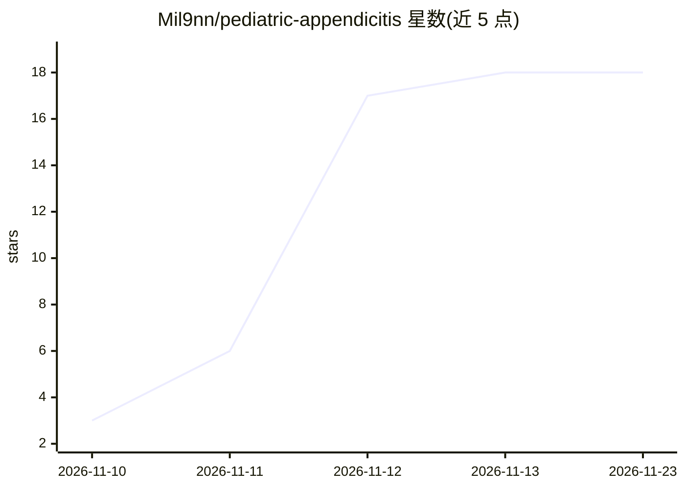

# Mil9nn/pediatric-appendicitis

⭐ 18 · Jupyter Notebook · 推送 2026-11-11 · [GitHub](https://github.com/Mil9nn/pediatric-appendicitis) · 个人维护

**用机器学习预测儿童阑尾炎的教学科研项目，含 Streamlit 应用**

基于 UCI 的 Regensburg Pediatric Appendicitis 数据集（782 条记录、58 列），对儿童患者做阑尾炎二分类预测。比较逻辑回归与调参后的随机森林，分别使用临床+实验室特征和加入超声特征的两组特征集，采用 80/20 分层划分与五折交叉验证，评估 accuracy、precision、recall、F1 与 ROC-AUC。附带 Streamlit 应用，支持手动输入或上传报告自动填充并输出阑尾炎概率。README 声明仅供学生与研究者教学使用，不可用于临床诊断；数据来自单一来源且超声特征缺失率高（部分超过 70%）。

## 筛选速览

| 维度 | 判定 | 备注 |
|---|---|---|
| AI 角色 | `ai-native` | 本体是模型或模型工具 |
| 许可风险 | `none` | — |
| 部署形态 | `library` | 以包/库形式分发 |
| 模型依赖 | — | README 未给出锁定关系 |
| 硬件要求 | — | 无带数字的原话,不猜 |
| 安装摩擦 | `low` | 无编译、无系统依赖或容器化 |
| 成熟度 | `idea` | |

## 能力要点

- 逻辑回归与调参随机森林在两组特征集（临床+实验室 vs 加超声）上的对比实验
- 加入超声特征后测试集 ROC-AUC 从 0.819 提升到 0.951（单一测试划分）
- Streamlit 应用支持上传报告文件自动填充表单并预测风险
- 完整的 EDA、缺失值处理与防止结果泄漏的特征排除流程

## 适用场景

- 学习医疗数据上的监督二分类建模流程（EDA、调参、评估）
- 研究超声特征对儿童阑尾炎预测的贡献
- 通过表单或上传报告原型化演示预测应用

## 场景标签

`教程课程` · 领域:学习与行业

## 证据(README 行号)

> L3: This project aims to predict whether a pediatric patient is likely to have appendicitis using clinical, laboratory, 
> L15:  This project uses supervised binary classification to predict whether a patient has appendicitis. It compares pred
> L108: The project includes a Streamlit web application that allows a user to:

## 星数曲线

2026-11-10 3 → 2026-11-23 18（+15）

---
*卡片 v1 · prompt 1.4 · 生成 2026-11-18 · 置信度 mid · 依据 README sha `5e503a806a72` · [字段定义](../../DATASET.md)*
