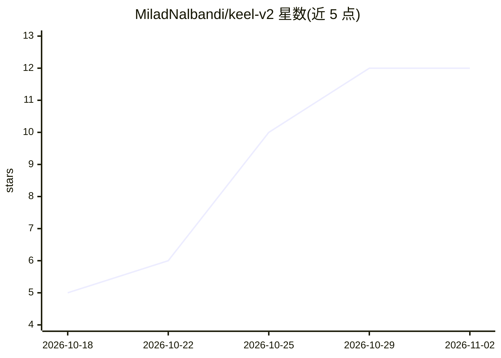

# MiladNalbandi/keel-v2

⭐ 12 · Python · MIT · 推送 2026-10-30 · [GitHub](https://github.com/MiladNalbandi/keel-v2) · 个人维护

**测试先行的 AI 编码代理平台：代理写代码，你审批关键步骤**

以 Docker 单容器运行的 AI 编码代理工作台：通过 Flow（quick/implement/fix/review/ship 等 13 种）驱动代理按测试先行方式写代码，在门禁处等待用户批准。提供 Web 仪表盘、终端应用（keel2）、Android 配对应用、MCP 服务器与 JetBrains/VS Code 插件，附带 Code Review 检查、Supervisor 插件、插件市场与预算/质量统计。模型接入支持 Claude、Codex、Copilot、Vertex AI 或本地模型（Ollama/LM Studio/vLLM）。

## 筛选速览

| 维度 | 判定 | 备注 |
|---|---|---|
| AI 角色 | `ai-native` | 本体是模型或模型工具 |
| 许可风险 | `permissive` | MIT |
| 部署形态 | `None` |  |
| 模型依赖 | local-ok | 支持本地模型 |
| 硬件要求 | — | 无带数字的原话,不猜 |
| 安装摩擦 | `low` | 无编译、无系统依赖或容器化 |
| 成熟度 | — | 结构信号不足 |

## 能力要点

- 13 种 Flow 工作流（实现/修复/审查/发布等），门禁处需人工批准
- 单 Docker 镜像内含仪表盘、终端应用与 MCP 服务器
- Code Review 的『评审者说得对吗』逐点核查与草稿回复
- 插件化架构：核心 + 可开关插件与市场，含 Supervisor 自动应答门禁

## 适用场景

- 让 AI 代理在我的项目里测试先行地实现功能，我审批关键步骤
- 在仪表盘或手机上处理等待批准的任务与 PR 评审
- 通过 MCP 把 keel 接入我自己的 AI 工具

## 场景标签

`编码 Agent` `代码审查` · 领域:编码与开发

## 证据(README 行号)

> L3:  AI agents write tested code for your project. You approve the important steps.
> L43: **3. Log in:** **Connections › Set up login**, then pick Claude, Codex, GitHub Copilot, Vertex AI or a local model

## 星数曲线

2026-10-18 5 → 2026-11-02 12（+7）

---
*卡片 v1 · prompt 1.4 · 生成 2026-11-01 · 置信度 high · 依据 README sha `4a5b03e3b634` · [字段定义](../../DATASET.md)*
