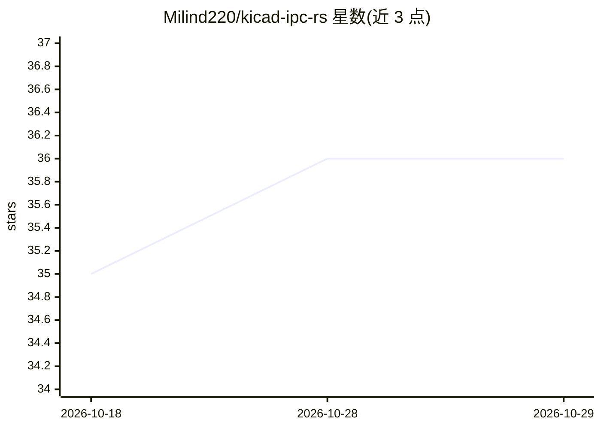

# Milind220/kicad-ipc-rs

⭐ 36 · Rust · MIT · 推送 2026-05-25 · [GitHub](https://github.com/Milind220/kicad-ipc-rs) · [官网](https://milind220.github.io/kicad-ipc-rs/) · 个人维护

**KiCad IPC API 的 Rust 绑定库，异步优先、全命令覆盖**

Rust 语言编写的 KiCad IPC API 客户端库，实现 KiCad v10.0.1 全部 59 个命令，提供类型安全的 PCB 条目模型（原始 IPC 层、只读 PcbItem 层、可编辑 EditablePcbItem 层）。默认异步 API 基于 Tokio，另提供 blocking 特性的同步封装。消费者无需 protobuf 依赖或 KiCad 源码检出，绑定由维护者从 KiCad 上游再生成。当前为 Beta 状态，未发布分支含对 0.4.x 的破坏性变更。给需要在 Rust 程序或 agent 中程序化控制 KiCad 的开发者使用。

## 筛选速览

| 维度 | 判定 | 备注 |
|---|---|---|
| AI 角色 | `ai-enhanced` | 去掉 AI 部分产品仍成立 |
| 许可风险 | `permissive` | MIT |
| 部署形态 | `None` |  |
| 模型依赖 | — | README 未给出锁定关系 |
| 硬件要求 | — | 无带数字的原话,不猜 |
| 安装摩擦 | `low` | 无编译、无系统依赖或容器化 |
| 成熟度 | `idea` | |

## 能力要点

- KiCad v10.0.1 全部 59 个 IPC 命令实现，CI 测试覆盖
- 异步 API（默认）与 blocking 特性同步封装双形态
- 三层 PCB 条目模型：raw / 只读 / 可编辑，支持 commit 会话安全修改
- protobuf 生成代码内置，消费者零 protobuf 依赖

## 适用场景

- 在 Rust 程序中读写与修改 KiCad PCB 板图
- 自动化 EDA 流程：批量创建文本、丝印、查询网络与选中项
- 为 KiCad 构建自动化工具或 agent 的程序化接口层

## 场景标签

 · 领域:EDA/电子设计自动化

## 证据(README 行号)

> L5: Control KiCad programmatically from Rust with an async-first API and optional blocking wrappers.
> L6: - **100% API coverage** (59/59 KiCad v10.0.1 commands)
> L29: - **KiCad 10.0.1+** running with the IPC API enabled

## 星数曲线

2026-10-18 35 → 2026-10-29 36（+1）

---
*卡片 v1 · prompt 1.4 · 生成 2026-10-25 · 置信度 mid · 依据 README sha `c4821ddb7ba2` · [字段定义](../../DATASET.md)*
