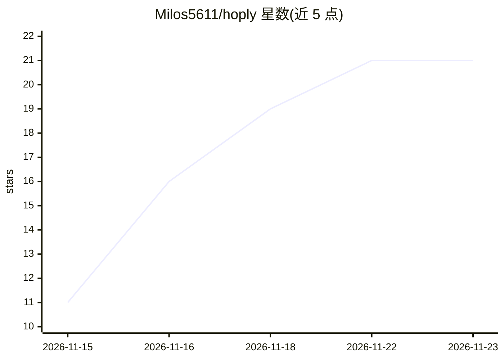

# Milos5611/hoply

⭐ 21 · Swift · MIT · 推送 2026-11-19 · [GitHub](https://github.com/Milos5611/hoply) · [官网](https://hoply.dev) · 个人维护

**macOS 菜单栏应用：监控多个 AI 编码 agent 的会话、费用与限额**

面向同时运行多个 AI 编码 agent 的 Mac 用户的菜单栏监控工具。通过 hooks、OpenTelemetry 与读取本地会话文件，追踪 Claude Code、Codex CLI、Copilot CLI、JetBrains 内 Copilot 与 Qwen Code 的实时会话状态、token 与 API 等效成本，并按仓库分组；等待用户操作的会话置顶并通知。另监控 vLLM、Ollama、llama.cpp 等本地模型服务器的速度与请求数，展示 Claude 与 Codex 套餐限额。数据全部留在本机，安装包经 Apple 签名公证，早期访问阶段免费。

## 筛选速览

| 维度 | 判定 | 备注 |
|---|---|---|
| AI 角色 | `ai-ecosystem` | LLM/agent 周边工具 |
| 许可风险 | `permissive` | MIT |
| 部署形态 | `None` |  |
| 模型依赖 | — | README 未给出锁定关系 |
| 硬件要求 | — | 无带数字的原话,不猜 |
| 安装摩擦 | `low` | 无编译、无系统依赖或容器化 |
| 成熟度 | `idea` | |

## 能力要点

- 通过 hooks/OpenTelemetry/会话文件追踪 5 种编码 agent 的实时会话与成本
- 监控 vLLM/llama.cpp/Ollama 等 OpenAI 兼容模型服务器的运行指标
- Claude 5 小时与周限额、Codex 限额的消耗速率与 80%/95% 告警
- 监听器仅绑定 127.0.0.1，无账号、无分析、无崩溃上报

## 适用场景

- 同时跑多个编码 agent 时不用反复切终端查看状态
- 按项目/模型/日期核算 agent 的 API 等效成本
- 盯住 Claude 套餐限额避免被限流
- 顺带监控本机模型服务器的负载与吞吐

## 场景标签

`LLM 可观测性` · 领域:评测与运维

## 证据(README 行号)

> L3: **A Mac menu bar app that shows what your AI coding agents are doing, what they cost, and when they need you.**
> L5: Hoply watches Claude Code, Codex CLI, Copilot CLI, Copilot in JetBrains and Qwen Code, plus the model servers you ru
> L58: - **Live sessions** for Claude Code, Codex CLI, Copilot CLI, Copilot in JetBrains and Qwen Code, grouped by

## 星数曲线

2026-11-15 11 → 2026-11-23 21（+10）

---
*卡片 v1 · prompt 1.4 · 生成 2026-11-18 · 置信度 high · 依据 README sha `ee18843bb8c0` · [字段定义](../../DATASET.md)*
