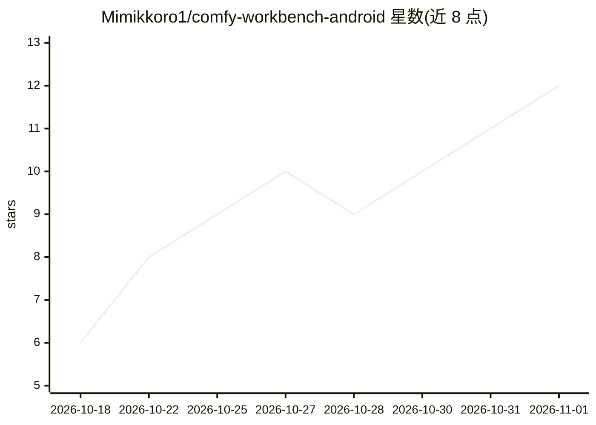

# Mimikkoro1/comfy-workbench-android

⭐ 12 · Kotlin · GPL-3.0 · 推送 2026-10-25 · [GitHub](https://github.com/Mimikkoro1/comfy-workbench-android) · 个人维护 · 中文 README

**手机直连自己电脑 ComfyUI 出图的安卓客户端**

原生 Android（Kotlin + Jetpack Compose）应用，通过 HTTP + WebSocket 直连用户自建的 ComfyUI 服务器，在手机上提交文生图、图生图、图生视频、反推提示词任务，无云端中转。自带 6 个内置模板开箱可用，也可导入 API 格式工作流 JSON，将提示词、种子、尺寸、LoRA 等参数映射为手机控件。定位不是节点编辑器：节点连线留在电脑端，手机只填参数和出图。支持队列管理、断线续查、前台服务后台生成、多服务器保存与 Basic Auth 远程访问。要求 Android 8.0+，电脑端需自行运行 ComfyUI。

## 筛选速览

| 维度 | 判定 | 备注 |
|---|---|---|
| AI 角色 | `ai-native` | 本体是模型或模型工具 |
| 许可风险 | `viral` | GPL-3.0 |
| 部署形态 | `desktop` | 安装包/桌面程序 |
| 模型依赖 | — | README 未给出锁定关系 |
| 硬件要求 | — | 无带数字的原话,不猜 |
| 安装摩擦 | `medium` | 含编译或系统依赖之一 |
| 成熟度 | — | 结构信号不足 |

## 能力要点

- HTTP + WebSocket 直连自有 ComfyUI，无云端中转，数据只在手机与自己的机器间流动
- 6 个内置模板开箱出图，可导入 API 格式 JSON 将工作流参数映射为手机控件
- 任务先落库再提交，断线后以队列和历史为准续查
- 前台服务保障锁屏/切后台生成不中断

## 适用场景

- 人不在电脑前时用已调好的工作流在手机上出图
- 把常用 ComfyUI 工作流变成手机上的简单参数面板
- 图生图、图生视频与反推提示词的移动端操作

## 场景标签

`图像生成` · 领域:内容生成

## 证据(README 行号)

> L11: **Comfy工作台** 是一个原生 Android（Kotlin + Jetpack Compose）应用。自带 6 个内置模板，开箱就能出图；也可以把自己的 ComfyUI 工作流导出成 API 格式导进来。参数变成几个输入框
> L34: - **直连你的 ComfyUI**：HTTP + WebSocket，实时进度，没有云端中转。提示词、参数、图片只经过手机和你自己的机器
> L184: **Comfy Workbench** is a native Android app that drives your own ComfyUI. It ships with 6 built-in templates, so y

## 星数曲线

2026-10-18 6 → 2026-11-01 12（+6）

---
*卡片 v1 · prompt 1.4 · 生成 2026-11-01 · 置信度 high · 依据 README sha `9b3ce1b81f9b` · [字段定义](../../DATASET.md)*
