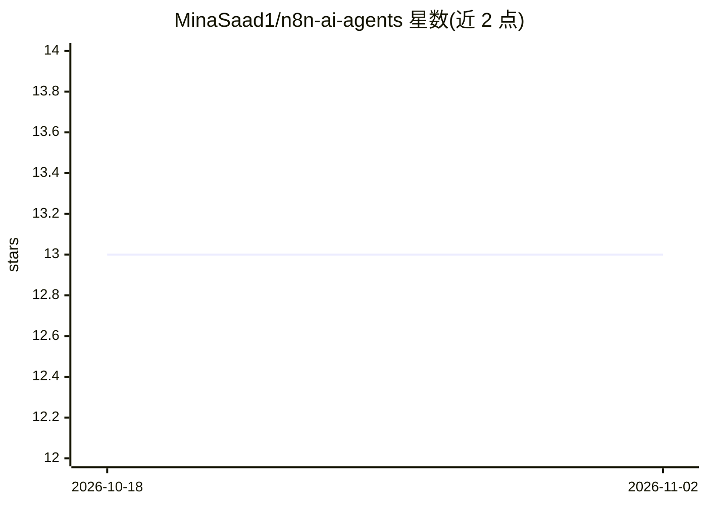

# MinaSaad1/n8n-ai-agents

⭐ 13 · MIT · 推送 2026-09-21 · [GitHub](https://github.com/MinaSaad1/n8n-ai-agents) · [官网](https://www.mina-saad.com) · 个人维护

**17 个生产级 n8n AI agent 模板策展目录**

收录 17 个可在 n8n 中导入运行的工作流模板，每条附工作流 JSON、画布渲染、架构说明与安全文档，共享同一套约定。覆盖四种架构形态：工具调用型 agent（如 Supabase/Postgres 数据分析、Power BI 分析、Firecrawl 线索猎手）、固定流程自动化（KPI 简报、邮件分诊等）、带质量闸门的 agent 管道、模型不产出最终答案的决策系统。模型侧主要使用 Claude Sonnet 4.6，经 Anthropic 或 OpenRouter 接入。

## 筛选速览

| 维度 | 判定 | 备注 |
|---|---|---|
| AI 角色 | `ai-knowledge` | 知识聚合/清单类 |
| 许可风险 | `permissive` | MIT |
| 部署形态 | `None` |  |
| 模型依赖 | — | README 未给出锁定关系 |
| 硬件要求 | — | 无带数字的原话,不猜 |
| 安装摩擦 | `low` | 无编译、无系统依赖或容器化 |
| 成熟度 | — | 结构信号不足 |

## 能力要点

- 17 个端到端可运行的 n8n 工作流模板，含 JSON 与画布文档
- 按工具型 agent/自动化/agent 管道/决策系统四类架构组织
- 每个模板配架构说明、安全文档与独立仓库
- 统一约定：学会一个即可理解其余模板

## 适用场景

- 导入模板快速搭建数据分析、邮件分诊、线索评分等自动化流程
- 参考不同 agent 架构形态（工具调用/质量闸门/决策系统）的 n8n 实现
- 为生产环境选型带安全文档的现成 agent 工作流

## 场景标签

`精选清单` `工作流自动化` · 领域:效率与自动化

## 证据(README 行号)

> L3: Seventeen production-ready n8n templates. Every one ships the workflow JSON, a canvas render, an architecture write-
> L11: |#|Template|What it does|Trigger|

## 星数曲线

2026-10-18 13 → 2026-11-02 13（+0）

---
*卡片 v1 · prompt 1.4 · 生成 2026-10-31 · 置信度 high · 依据 README sha `17fd8416d25a` · [字段定义](../../DATASET.md)*
