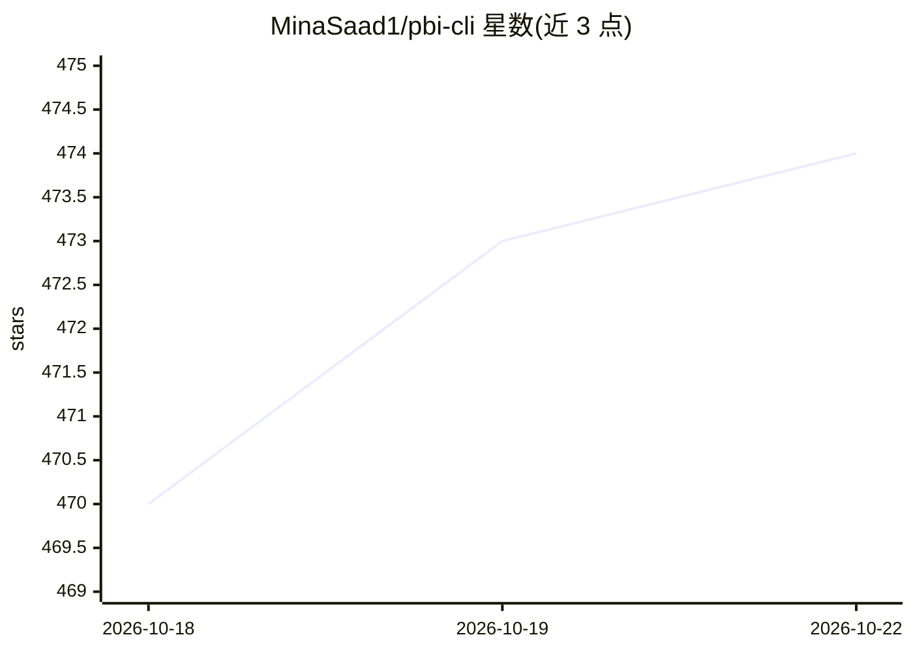

# MinaSaad1/pbi-cli

⭐ 474 · Python · MIT · 推送 2026-10-21 · [GitHub](https://github.com/MinaSaad1/pbi-cli) · [官网](https://mina-saad.com/pbi-cli) · 个人维护

**面向 Claude Code 的 Power BI CLI：语义模型与报表操作技能**

给 Claude Code 等 AI agent 提供 Power BI 操作能力的 Python CLI。分两层：语义模型层通过 .NET TOM/ADOMD 进程内互操作连接 Power BI Desktop，支持 DAX 执行、建模、快照、RLS、诊断追踪；报表层直接读写 PBIR JSON 文件，覆盖 32 种视觉对象、页面、主题、过滤与自定义视觉开发。安装后注册 13 个 Claude 技能，共 27 个命令组，支持 --json 输出与 REPL 模式。要求 Windows、Python 3.10+ 且 Power BI Desktop 运行中。

## 筛选速览

| 维度 | 判定 | 备注 |
|---|---|---|
| AI 角色 | `ai-ecosystem` | LLM/agent 周边工具 |
| 许可风险 | `permissive` | MIT |
| 部署形态 | `library` | 以包/库形式分发 |
| 模型依赖 | locked-api |  |
| 硬件要求 | — | 无带数字的原话,不猜 |
| 安装摩擦 | `low` | 无编译、无系统依赖或容器化 |
| 成熟度 | — | 结构信号不足 |

## 能力要点

- .NET TOM/ADOMD 进程内互操作连接 Power BI Desktop，无需 MCP 服务器
- 直接读写 PBIR 报表 JSON，支持 .pbip 工程
- 注册 13 个 Claude Code 技能，27 个命令组，--json 机器可读输出
- 自定义视觉开发闭环（脚手架、tsc 迭代、.pbiviz 打包与导入）

## 适用场景

- 让 Claude 批量创建度量值、调试 DAX、测试 RLS
- 用自然语言搭建和管理 Power BI 报表页面与视觉对象
- 对语义模型做快照、diff 与健康检查
- 在 Claude Code 中开发并嵌入自定义 Power BI 视觉

## 场景标签

`数据分析` `代码生成` · 领域:效率与自动化

## 证据(README 行号)

> L3:  Give Claude Code the Power BI skills it needs.
> L118: - **Semantic Model layer** -- Direct in-process .NET interop from Python to Power BI Desktop via TOM/ADOMD. No MCP

## 星数曲线

2026-10-18 470 → 2026-10-22 474（+4）

---
*卡片 v1 · prompt 1.4 · 生成 2026-10-21 · 置信度 mid · 依据 README sha `bb01342ec39b` · [字段定义](../../DATASET.md)*
