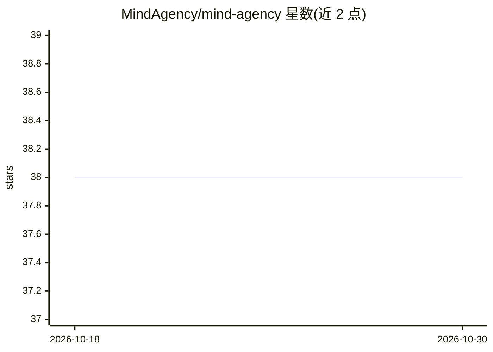

# MindAgency/mind-agency

⭐ 38 · TypeScript · Apache-2.0 · 推送 2026-08-15 · [GitHub](https://github.com/MindAgency/mind-agency) · [官网](https://mindagency.cn/) · 组织维护 · 中文 README

**本地优先的多智能体协作平台：组队、分派任务、跑工作流**

Mind Agency 是一个本地优先的多智能体协作平台：创建带角色、画像与记忆的专用 agent，编组协作、分派任务，用 YAML 定义带 DAG 依赖、检查点恢复与审核门的工作流，并保留可审计记录。技术栈为 Next.js 界面、内嵌 WebSocket 事件层、工作流引擎、MCP 工具与 Electron 桌面打包；数据持久化在本地文件系统。支持 Claude、Codex 兼容 provider 及可配置模型档案。当前分支修复测试/运行时回归；主要打包目标为 Windows，需 Node.js 18+ 从源码运行。

## 筛选速览

| 维度 | 判定 | 备注 |
|---|---|---|
| AI 角色 | `ai-ecosystem` | LLM/agent 周边工具 |
| 许可风险 | `permissive` | Apache-2.0 |
| 部署形态 | `library` | 以包/库形式分发 |
| 模型依赖 | locked-api |  |
| 硬件要求 | — | 无带数字的原话,不猜 |
| 安装摩擦 | `low` | 无编译、无系统依赖或容器化 |
| 成熟度 | — | 结构信号不足 |

## 能力要点

- 带角色、记忆与群组成员关系的多 agent 团队
- YAML 工作流引擎：DAG 依赖、检查点恢复、审核门、重试
- 类型化事件总线：outbox 持久化、死信处理、背压保护
- 技能安装与按 agent 启用，暴露 MCP 工具

## 适用场景

- 组建多个专用 agent 分工完成复杂任务
- 用可恢复的工作流编排 agent 协作并审核产出
- 在本地留存 agent 行为的审计记录

## 场景标签

`多智能体` · 领域:Agent 开发

## 证据(README 行号)

> L18: Mind Agency is a local-first multi-agent collaboration platform. It lets you create specialized AI agents, organize
> L91: |Provider support|Claude, Codex-compatible providers, and configurable model profiles.|

## 星数曲线

2026-10-18 38 → 2026-10-30 38（+0）

---
*卡片 v1 · prompt 1.4 · 生成 2026-10-25 · 置信度 high · 依据 README sha `7270f42140a2` · [字段定义](../../DATASET.md)*
