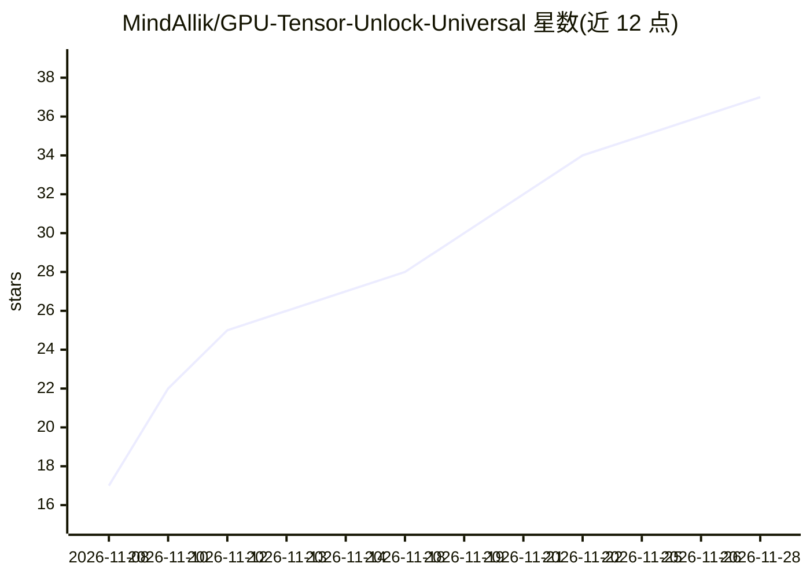

# MindAllik/GPU-Tensor-Unlock-Universal

⭐ 37 · C · GPL-2.0 · 推送 2026-11-20 · [GitHub](https://github.com/MindAllik/GPU-Tensor-Unlock-Universal) · 个人维护

**消费级 RTX 显卡 Tensor Core FMLA32 限速解锁与基准测试工具**

面向 GeForce RTX 20/30/40 系列的底层工具：在操作系统驱动绑定前修改易失性 GPU 寄存器，移除 VBIOS 对 FMLA32（FP16/BF16/TF32/FP8→FP32 累加）的半速限制，恢复 2.00x 吞吐直至下次冷关机，不写入 SPI flash。Windows 侧经 UEFI USB 引导（BOOTX64.EFI），Linux 侧经 gpu_unlock.ko 内核模块（DKMS/早期引导）；含自动硬件识别、VBIOS 预检、CUDA PTX JIT 基准与多语言 UI。实测覆盖 RTX 4070 Ti（作者本机）等，部分卡型标注实验性。

## 筛选速览

| 维度 | 判定 | 备注 |
|---|---|---|
| AI 角色 | `ai-enhanced` | 去掉 AI 部分产品仍成立 |
| 许可风险 | `viral` | GPL-2.0 |
| 部署形态 | `None` |  |
| 模型依赖 | — | README 未给出锁定关系 |
| 硬件要求 | — | 无带数字的原话,不猜 |
| 安装摩擦 | `high` | 编译与系统依赖俱全 |
| 成熟度 | — | 结构信号不足 |

## 能力要点

- Windows UEFI 预引导与 Linux gpu_unlock.ko 双路径解锁 FMLA32 限速
- 多源硬件自动检测（NVML/CUDA/PCI 枚举）与 VBIOS ROM 预检校验
- 内置 CUDA PTX JIT 基准（7 种内核，BEFORE/AFTER 对比）
- 支持 EN/RU/ZH/HI 四语 UI 与一键 Markdown 诊断报告导出

## 适用场景

- 在消费级 RTX 卡上恢复 FP16/BF16/TF32→FP32 矩阵累加的全速率
- 解锁前后用 PTX 基准核验 Tensor Core 吞吐变化
- 为深度学习/推理负载提升寄存器级 Tensor Core 指令发射率

## 场景标签

 · 领域:GPU 硬件/底层系统工具

## 证据(README 行号)

> L5: **Pre-driver `FMLA32` Tensor Core unlocker and PTX benchmark console for GeForce RTX 40-series (Ada Lovelace), RTX 3
> L7: Consumer GeForce GPUs of the Ada Lovelace (`RTX 40xx`), Ampere (`RTX 30xx`), and Turing (`RTX 20xx`) generations car
> L38: 4. **Integrated CUDA PTX JIT Benchmark (`tensor_benchmark.py`)**

## 星数曲线

2026-11-08 17 → 2026-11-28 37（+20）

---
*卡片 v1 · prompt 1.4 · 生成 2026-11-18 · 置信度 high · 依据 README sha `724e3d0a8ac7` · [字段定义](../../DATASET.md)*
