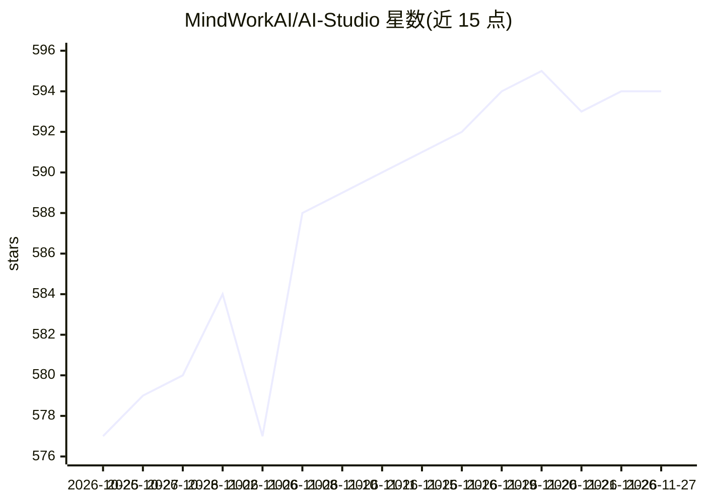

# MindWorkAI/AI-Studio

⭐ 594 · C# · NOASSERTION · 推送 2026-11-26 · [GitHub](https://github.com/MindWorkAI/AI-Studio) · [官网](https://MindWorkAI.org/) · 组织维护

**给个人与企业的跨平台桌面 LLM 客户端，统一接入多家云端与本地模型**

MindWork AI Studio 是运行于 macOS、Windows 与 Linux 的免费桌面应用，为多个 LLM 提供统一界面；用户自带 API key 接入 OpenAI、Anthropic、Google Gemini 等云端服务，或通过 llama.cpp、ollama、vLLM 等运行本地模型。内置免提示词的助手、模型自主调用的工具（网页搜索等）、基于本机索引与 Qdrant 的本地 RAG、语音录制与音视频转录、ERI 数据源接入，以及面向企业 IT 的集中配置与策略管理。

## 筛选速览

| 维度 | 判定 | 备注 |
|---|---|---|
| AI 角色 | `ai-native` | 本体是模型或模型工具 |
| 许可风险 | `none` | NOASSERTION |
| 部署形态 | `None` |  |
| 模型依赖 | local-ok | 支持本地模型 |
| 硬件要求 | — | 无带数字的原话,不猜 |
| 安装摩擦 | `medium` | 含编译或系统依赖之一 |
| 成熟度 | — | 结构信号不足 |

## 能力要点

- 统一界面接入多家云服务商与本地运行时，用户自带 API key
- 内置无需提示词的助手与助手插件构建器（Assistant Builder）
- 本地 RAG：索引保存在本机，可选自托管 embedding 提供方
- 企业 IT 集中管理：下发配置、锁定设置、禁用提供方

## 适用场景

- 用一个桌面应用在多家 LLM 服务商之间切换使用
- 让 AI 基于本机文件夹或邮箱中的文档回答问题
- 录制并转录语音与音视频文件
- 由组织 IT 部门统一向全员部署 AI 工具与配置

## 场景标签

`AI 助手` `RAG` · 领域:对话与助手

## 证据(README 行号)

> L28: MindWork AI Studio is a free desktop app for macOS, Windows, and Linux. It provides a unified user interface for in
> L35: - **Independence**: You are not tied to any single provider. Instead, you can choose the providers that best suit y

## 星数曲线

2026-10-25 577 → 2026-11-27 594（+17）

---
*卡片 v1 · prompt 1.4 · 生成 2026-11-25 · 置信度 high · 依据 README sha `a4060cb70770` · [字段定义](../../DATASET.md)*
