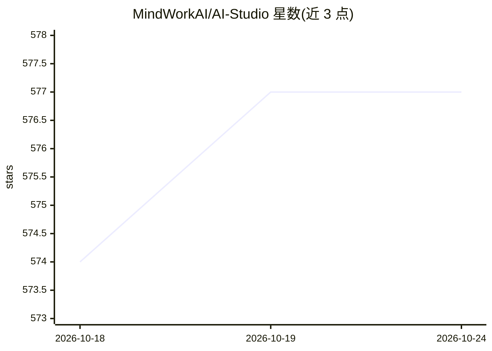

# MindWorkAI/AI-Studio

⭐ 577 · C# · NOASSERTION · 推送 2026-10-23 · [GitHub](https://github.com/MindWorkAI/AI-Studio) · [官网](https://MindWorkAI.org/) · 组织维护

**跨平台桌面 LLM 客户端：统一界面接入本地与云端各家模型**

面向终端用户的免费桌面应用（macOS/Windows/Linux），以自带 API key 的方式使用 OpenAI、Anthropic、Google、Mistral、DeepSeek 等云端提供商，以及 llama.cpp、ollama、vLLM、LM Studio 等自托管模型。提供免提示词的助手、模型自主调用工具（网页搜索等）、语音输入与音视频转录、本地 RAG（beta）、文档分析与企业 IT 集中管理配置。宣称可在约 100 欧元的 Raspberry Pi 等低成本硬件上运行，按 API 用量计费，应用本身免费含商业用途。

## 筛选速览

| 维度 | 判定 | 备注 |
|---|---|---|
| AI 角色 | `ai-native` | 本体是模型或模型工具 |
| 许可风险 | `none` | NOASSERTION |
| 部署形态 | `None` |  |
| 模型依赖 | local-ok | 支持本地模型 |
| 硬件要求 | — | 无带数字的原话,不猜 |
| 安装摩擦 | `low` | 无编译、无系统依赖或容器化 |
| 成熟度 | `idea` | |

## 能力要点

- 统一界面接入 20 余家云端提供商与 llama.cpp/ollama/vLLM 等自托管模型
- 助手、模型自主调用工具（Web 搜索/读网页/搜索 Confluence）
- 语音输入与音视频文件转录，转录提供商可选自托管
- 本地 RAG（beta）与提示注入防护
- 企业 IT 集中管理提供商、助手、模板与工具配置

## 适用场景

- 在多个 LLM 提供商与本地模型之间切换使用，不绑定单一服务
- 用预设助手完成翻译、文档分析等日常任务而无需编写提示词
- 企业在低配置硬件上低成本部署统一的 LLM 使用入口并由 IT 集中管理

## 场景标签

`AI 助手` `模型网关` · 领域:Agent 开发

## 证据(README 行号)

> L28: MindWork AI Studio is a free desktop app for macOS, Windows, and Linux. It provides a unified user interface for in
> L55: - **Tools**: AI models can use tools on their own, such as Web Search, Read Web Page, or Search Confluence. When yo

## 星数曲线

2026-10-18 574 → 2026-10-24 577（+3）

---
*卡片 v1 · prompt 1.4 · 生成 2026-10-22 · 置信度 high · 依据 README sha `fb7ecc443df3` · [字段定义](../../DATASET.md)*
