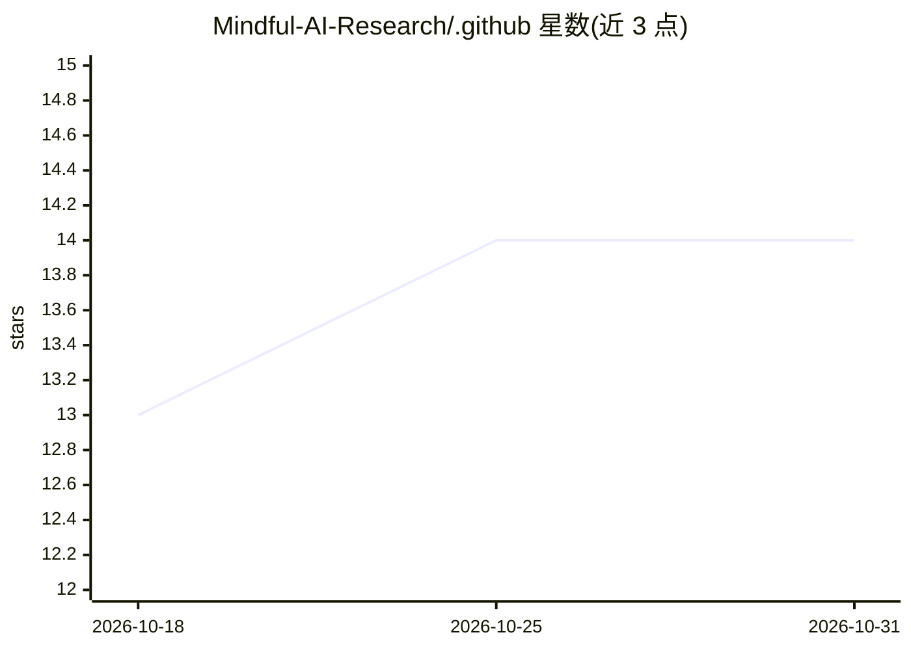

# Mindful-AI-Research/.github

⭐ 14 · HTML · MIT · 推送 2026-10-29 · [GitHub](https://github.com/Mindful-AI-Research/.github) · [官网](https://github.com/Mindful-AI-Research/) · 组织维护

**Mindful AI 组织简介：面向企业的 AI 助手/Agent 与治理知识库**

开源组织 Mindful-AI-Research 的 .github 组织主页 README，由创始人 Fabiana Campanari 与 42+ 贡献者维护。内容为组织介绍：使命（人本 AI）、AI 治理与 GRC 合规框架（对齐巴西 AI 战略、EU AI Act、LGPD/GDPR）、声称提供 Copilots、Agents、Bots 与预测分析等解决方案方向，并附监督/无监督机器学习算法对比表和 AI 知识链接（Google 提示工程指南、Stanford AI 等）。无安装或运行说明，不构成可安装产品。

## 筛选速览

| 维度 | 判定 | 备注 |
|---|---|---|
| AI 角色 | `ai-knowledge` | 知识聚合/清单类 |
| 许可风险 | `permissive` | MIT |
| 部署形态 | `None` |  |
| 模型依赖 | — | README 未给出锁定关系 |
| 硬件要求 | — | 无带数字的原话,不猜 |
| 安装摩擦 | `low` | 无编译、无系统依赖或容器化 |
| 成熟度 | — | 结构信号不足 |

## 能力要点

- 组织主页 README，声明 AI 治理与 GRC 合规框架（EU AI Act/LGPD/GDPR 对齐）
- 列举 Copilots、Agents、Bots、预测分析等技术方向
- 附监督与无监督机器学习算法对比表（决策树/SVM/kNN/XGBoost/K-Means 等）
- 策展外部 AI 知识链接（提示工程指南、AGI 定义、AI 网络安全指南等）

## 适用场景

- 了解 Mindful AI 组织的使命、治理框架与技术方向
- 查阅常见机器学习算法的对比表
- 寻找 AI 治理与负责任 AI 的参考框架表述

## 场景标签

 · 领域:AI 组织介绍/知识聚合

## 证据(README 行号)

> L117: ###### 𖤐 *Curated AI Knowledge, Learning & Perspectives* 𖤐
> L342: ## Overview and Comparison of Common ***Supervised*** Machine Learning Algorithms (Part 1)

## 星数曲线

2026-10-18 13 → 2026-10-31 14（+1）

---
*卡片 v1 · prompt 1.4 · 生成 2026-10-31 · 置信度 mid · 依据 README sha `3c085f41f125` · [字段定义](../../DATASET.md)*
