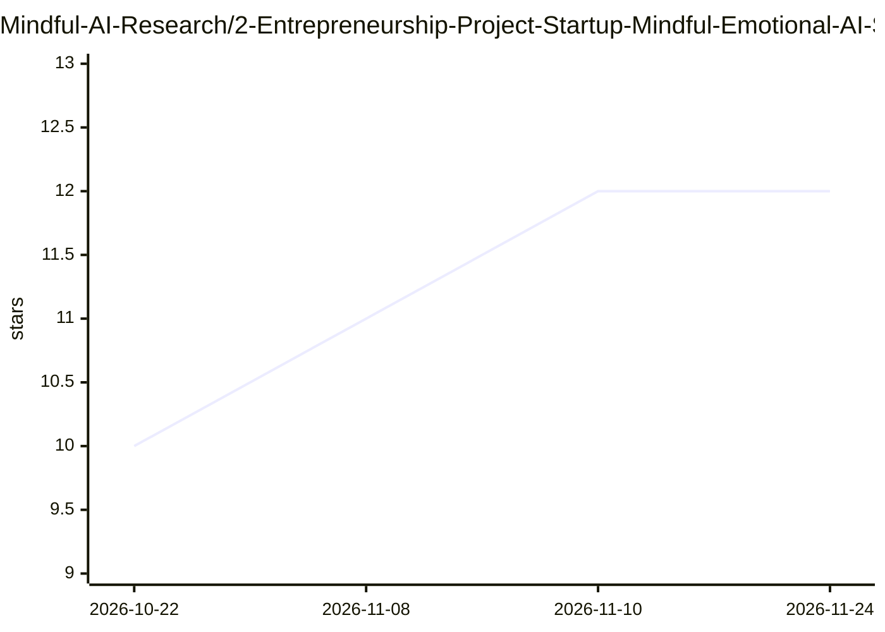

# Mindful-AI-Research/2-Entrepreneurship-Project-Startup-Mindful-Emotional-AI-Scalable-Ethical-InferenceOps

⭐ 12 · Jupyter Notebook · MIT · 推送 2026-11-23 · [GitHub](https://github.com/Mindful-AI-Research/2-Entrepreneurship-Project-Startup-Mindful-Emotional-AI-Scalable-Ethical-InferenceOps) · [官网](https://github.com/Mindful-AI-Assistants/Project-InferenceOps-Embedded-Innovation) · 组织维护

**PUC-SP 学生的情感 AI 创业项目文档：方案、合规分析与团队架构**

PUC-SP 人文 AI 与数据科学本科创新实验室的创业项目仓库，内容为 Mindful Emotional AI 创业方案的介绍文档：提出基于多模态数据（语音、文本、面部表情、生理信号）实时情感推断的平台设想，包含 InferenceOps 概念讲解、训练与推断流程说明、EU AI Act 与 GDPR/LGPD 合规分析、目标行业应用场景、团队角色与 24/7 运营安排。README 明确标注按 EU AI Act 自评为高风险/可能不合规。仓库无代码实现、无安装或运行说明，属于课程项目展示与 slides/研究材料聚合。

## 筛选速览

| 维度 | 判定 | 备注 |
|---|---|---|
| AI 角色 | `ai-knowledge` | 知识聚合/清单类 |
| 许可风险 | `permissive` | MIT |
| 部署形态 | `None` |  |
| 模型依赖 | — | README 未给出锁定关系 |
| 硬件要求 | — | 无带数字的原话,不猜 |
| 安装摩擦 | `low` | 无编译、无系统依赖或容器化 |
| 成熟度 | — | 结构信号不足 |

## 能力要点

- 面向 EU AI Act 与巴西 AI 法案的情感识别合规性自我分析
- 多模态情感分析平台方案（语音/文本/视频/生理信号）
- InferenceOps 训练与推断概念的教学性讲解
- 关联 PUC-SP 课程系列的多个项目仓库与 slides

## 适用场景

- 了解情感识别 AI 在欧盟监管下的风险分类
- 参考学生创业项目在 AI 伦理治理方面的写作框架

## 场景标签

 · 领域:AI 治理/教育项目文档

## 证据(README 行号)

> L103: **Mindful Emotional AI** is a project dedicated to creating an innovative startup currently being developed by the
> L44: > * This repository is part of the main project Ethical Entrepreneurship amd Innovation in Humanistic AI & Data Sci
> L21: > #### * 🚧 6th AI Congress PUC-SP, Nov 2025 - Brazil & the EU Artificial Intelligence Act: Access Full Research & D

## 星数曲线

2026-10-22 10 → 2026-11-24 12（+2）

---
*卡片 v1 · prompt 1.4 · 生成 2026-11-18 · 置信度 high · 依据 README sha `e98f2ff20892` · [字段定义](../../DATASET.md)*
