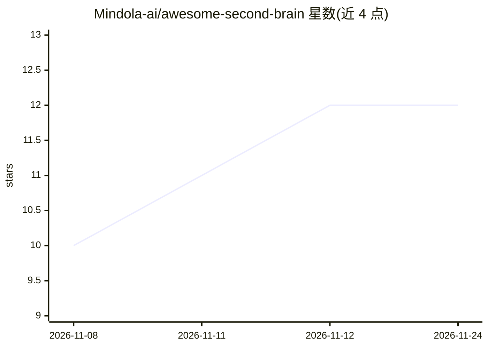

# Mindola-ai/awesome-second-brain

⭐ 12 · CC0-1.0 · 推送 2026-09-18 · [GitHub](https://github.com/Mindola-ai/awesome-second-brain) · [官网](https://mindola.ai) · 组织维护

**构建第二大脑的工具与资源中立清单（笔记/PKM/个人 AI）**

社区维护的中立清单，收录构建个人第二大脑（捕捉所学、随时检索）所需的工具、方法与资源，覆盖个人 AI 与数字分身、笔记文档上的 AI 问答、笔记与 PKM 应用、开源自托管知识库四类。每条目附标签（oss/selfhost/local/free/paid/ai/mobile）与官方链接，声明不排名、不背书任何产品，由 Mindola 团队维护并接受社区贡献。

## 筛选速览

| 维度 | 判定 | 备注 |
|---|---|---|
| AI 角色 | `ai-knowledge` | 知识聚合/清单类 |
| 许可风险 | `viral` | CC0-1.0 |
| 部署形态 | `None` |  |
| 模型依赖 | — | README 未给出锁定关系 |
| 硬件要求 | — | 无带数字的原话,不猜 |
| 安装摩擦 | `low` | 无编译、无系统依赖或容器化 |
| 成熟度 | — | 结构信号不足 |

## 能力要点

- 四大板块：个人 AI/数字分身、笔记 AI、PKM 应用、开源自托管
- 统一标签体系标注开源/自托管/本地优先/付费/AI 等属性
- 声明中立立场：不排名、不背书，条目均链官方站点或源码仓库

## 适用场景

- 为个人知识管理选型笔记或自托管知识库工具
- 寻找能基于自己笔记文档做问答的个人 AI 助手
- 了解个人 AI 分身/数字孪生类产品的生态分布

## 场景标签

`精选清单` `知识库管理` `AI 助手` · 领域:对话与助手

## 证据(README 行号)

> L1: # Awesome Second Brain Awesome
> L3: > A curated, neutral list of tools, methods, and resources for building a second brain.
> L9: **Tags:** `oss` open source, `selfhost` self-hostable, `local` local-first, `free` free tier, `paid` paid only, `ai`

## 星数曲线

2026-11-08 10 → 2026-11-24 12（+2）

---
*卡片 v1 · prompt 1.4 · 生成 2026-11-18 · 置信度 mid · 依据 README sha `4405a89c868e` · [字段定义](../../DATASET.md)*
