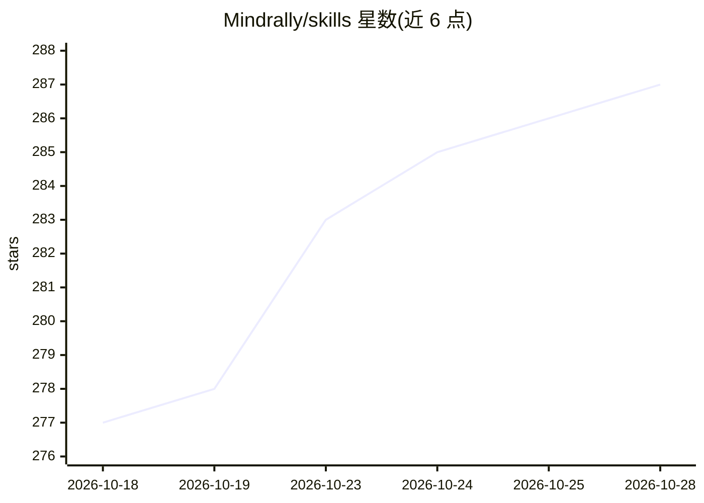

# Mindrally/skills

⭐ 287 · Apache-2.0 · 推送 2026-10-08 · [GitHub](https://github.com/Mindrally/skills) · [官网](https://mindrally.com) · 组织维护

**给 Claude Code 用户的 265+ 编码技能合集（Cursor 规则转换）**

由 Mindrally 维护的 Claude Code 技能集合：将 Cursor Rules（.cursorrules）转换为 SKILL.md 格式（YAML frontmatter + markdown 指南），覆盖前端、后端、移动端、AI/ML、DevOps、数据库、测试、区块链等类别共 265 个技能。通过 npx skills CLI 安装到当前项目或全局 ~/.claude/skills/，兼容 70+ 其他 agent；仓库同时是一个 Claude Code 插件市场，可用 /plugin 命令整体安装。CLI 需 Node.js。

## 筛选速览

| 维度 | 判定 | 备注 |
|---|---|---|
| AI 角色 | `ai-knowledge` | 知识聚合/清单类 |
| 许可风险 | `permissive` | Apache-2.0 |
| 部署形态 | `library` | 以包/库形式分发 |
| 模型依赖 | locked-api |  |
| 硬件要求 | — | 无带数字的原话,不猜 |
| 安装摩擦 | `medium` | 含编译或系统依赖之一 |
| 成熟度 | — | 结构信号不足 |

## 能力要点

- 265 个技能由 Cursor Rules 转换为 SKILL.md 格式
- npx skills CLI 支持单个/批量/全局安装，兼容 70+ agent
- 可作为 Claude Code 插件市场整体安装并自动更新
- 覆盖约 20 个类别：前端框架、后端、AI/ML、DevOps、移动端等

## 适用场景

- 给 Claude Code 添加特定框架/语言的编码规范上下文
- 一键为整个技术栈（如 Next.js 全栈）安装配套技能
- 把已有 Cursor 规则经验迁移到 Claude Code 工作流

## 场景标签

`提示工程` `精选清单` · 领域:Agent 开发

## 证据(README 行号)

> L19: These skills were converted from **Cursor Rules** (`.cursorrules` files) to the Claude Code skills format (`SKILL.m
> L25: Skills are reusable instruction sets that enhance Claude Code's capabilities for specific technologies, frameworks,
> L48: The `skills` CLI installs skills from this repo directly into Claude Code (and 70+ other agents) with no setup. It 

## 星数曲线

2026-10-18 277 → 2026-10-28 287（+10）

---
*卡片 v1 · prompt 1.4 · 生成 2026-10-22 · 置信度 high · 依据 README sha `7ff6620a230a` · [字段定义](../../DATASET.md)*
