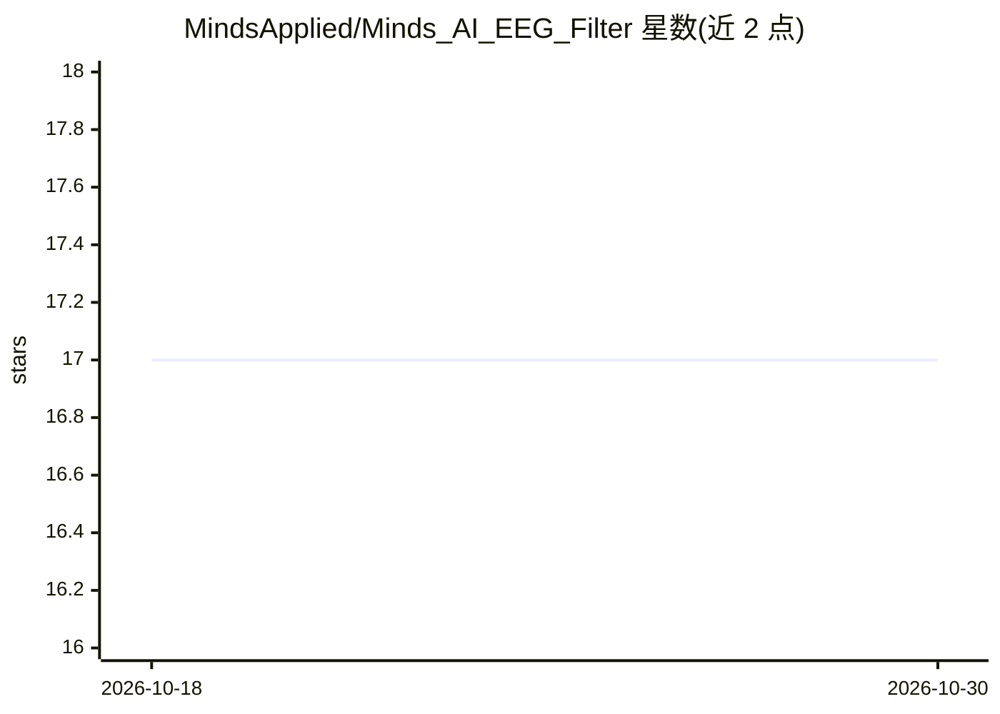

# MindsApplied/Minds_AI_EEG_Filter

⭐ 17 · Python · NOASSERTION · 推送 2026-02-25 · [GitHub](https://github.com/MindsApplied/Minds_AI_EEG_Filter) · [官网](https://www.minds-applied.com/) · 组织维护

**科研用 EEG 信号滤波库：去伪迹降噪，实时/离线均可用**

MindsApplied 发布的 EEG 信号滤波 Python 包：基于空间耦合与频段感知加权抑制运动/眼电伪迹，降低高频噪声、平滑基线漂移，重建平坦电极信号，单窗口延迟低于 0.018 秒。README 明确说明滤波器本身不使用深度学习、无需预训练，AI 仅因其在 AI 流水线中的用途而出现在命名中。单一超参数 tailoring_lambda 控制调整幅度，支持 1 秒实时窗口至 60 秒试次。附带两个仅限 Windows 的演示应用（实时流与离线上传），并链接 bioRxiv 预印本；公共版本限定 Python 3.10/3.11。

## 筛选速览

| 维度 | 判定 | 备注 |
|---|---|---|
| AI 角色 | `ai-enhanced` | 去掉 AI 部分产品仍成立 |
| 许可风险 | `none` | NOASSERTION |
| 部署形态 | `library` | 以包/库形式分发 |
| 模型依赖 | — | README 未给出锁定关系 |
| 硬件要求 | — | 无带数字的原话,不猜 |
| 安装摩擦 | `low` | 无编译、无系统依赖或容器化 |
| 成熟度 | — | 结构信号不足 |

## 能力要点

- 抑制瞬态运动/眼电伪迹并保留底层节律，重建平坦电极
- 单窗口延迟低于 0.018 秒，支持实时（1 秒起）与离线（最长 60 秒）
- 不使用深度学习、无需预训练或干净数据段
- 附实时流与离线上传两个可视化演示应用（含 SNR 指标）

## 适用场景

- 对多通道 EEG 数据做实时流式去伪迹与降噪
- 离线处理预录 EEG 试次并评估信噪比改善
- 作为 AI/脑机接口流水线前端的信号条件化步骤

## 场景标签

`科研工具` · 领域:学习与行业

## 证据(README 行号)

> L3: *Your* Minds AI Signal Filter uses spatial coupling and band-aware weighting to condition the signal based on the ph
> L5: - Suppresses artifacts like transient motion/ocular bursts while preserving underlying rhythms across channels

## 星数曲线

2026-10-18 17 → 2026-10-30 17（+0）

---
*卡片 v1 · prompt 1.4 · 生成 2026-10-30 · 置信度 high · 依据 README sha `894a9f9988f1` · [字段定义](../../DATASET.md)*
