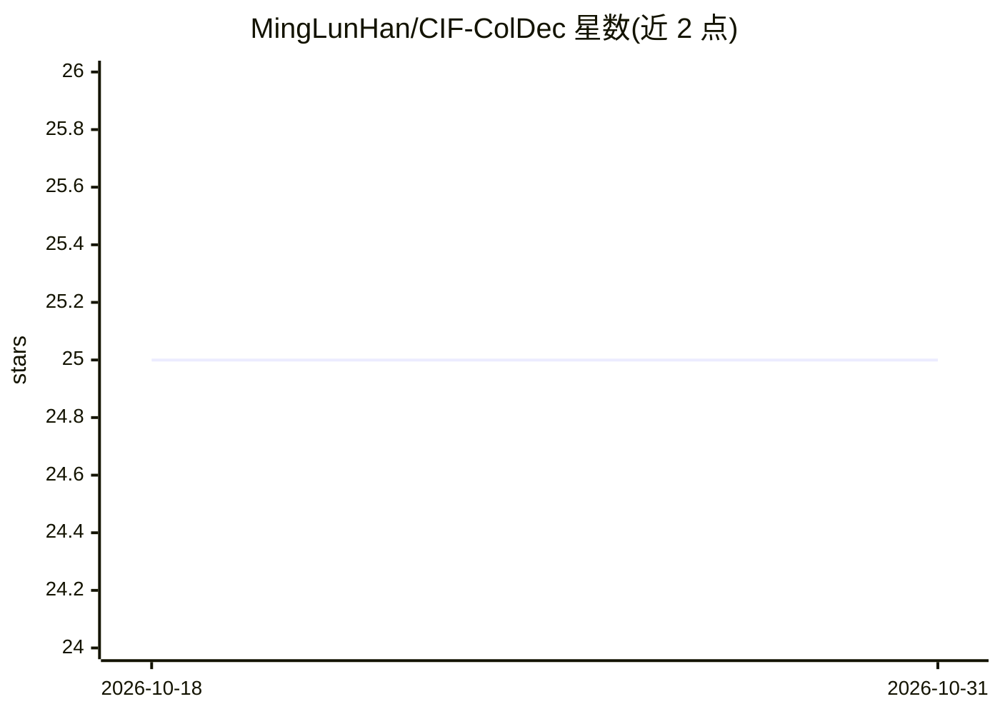

# MingLunHan/CIF-ColDec

⭐ 25 · Apache-2.0 · 推送 2026-07-14 · [GitHub](https://github.com/MingLunHan/CIF-ColDec) · [官网](https://ieeexplore.ieee.org/abstract/document/9747101) · 个人维护 · 中文 README

**ICASSP 2022 论文官方仓库：CIF-based ASR 的上下文偏置解码方法**

为论文 Improving End-to-End Contextual Speech Recognition with Fine-Grained Contextual Knowledge Selection（IEEE ICASSP 2022）提供复现与对比支持材料。ColDec 用于定制 CIF-based ASR 模型，通过 token 级声学表征整合文本知识，实现上下文化、定制化与个性化识别。README 主要包含数据集（LibriSpeech 模拟 biasing 列表与内部 160k 小时中英文数据集）、配置文件说明、结果与参考文献；未给出安装或训练命令。

## 筛选速览

| 维度 | 判定 | 备注 |
|---|---|---|
| AI 角色 | `ai-native` | 本体是模型或模型工具 |
| 许可风险 | `permissive` | Apache-2.0 |
| 部署形态 | `None` |  |
| 模型依赖 | — | README 未给出锁定关系 |
| 硬件要求 | — | 无带数字的原话,不猜 |
| 安装摩擦 | `low` | 无编译、无系统依赖或容器化 |
| 成熟度 | — | 结构信号不足 |

## 能力要点

- ColDec 利用 token 级声学表征整合文本知识做上下文偏置
- 提供 LibriSpeech 会话级 biasing 列表与统计信息
- 内部 160k 小时中英文数据集含会议人名/术语测试集
- config/ 目录覆盖 LibriSpeech 全部实验配置

## 适用场景

- 复现论文中的上下文语音识别实验
- 获取 LibriSpeech 上下文偏置评测数据与 biasing 列表
- 对比 CIF-based ASR 的上下文化方法

## 场景标签

`语音识别` · 领域:感知与多模态

## 证据(README 行号)

> L3: **Collaborative Decoding (ColDec) for Contextual & Customized CIF-based ASR**
> L10: > 📌 **Collaborative Decoding (ColDec)** is proposed to customize CIF-based ASR models. Its application to ASR **con
> L12: This repository provides all supporting materials for the paper **Improving End-to-End Contextual Speech Recognitio

## 星数曲线

2026-10-18 25 → 2026-10-31 25（+0）

---
*卡片 v1 · prompt 1.4 · 生成 2026-10-27 · 置信度 high · 依据 README sha `857e23b7eb7c` · [字段定义](../../DATASET.md)*
