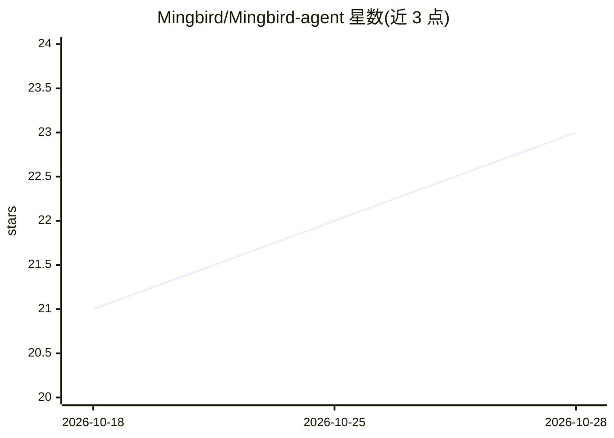

# Mingbird/Mingbird-agent

⭐ 23 · Python · Apache-2.0 · 推送 2026-10-22 · [GitHub](https://github.com/Mingbird/Mingbird-agent) · 个人维护 · 中文 README

**本地优先的桌面 agent 执行器：让 2–9B 小模型在核显笔记本上完成实际任务**

Windows（Linux/macOS 实验性）桌面客户端，围绕本地小模型做 agent 任务执行：写代码并跑测试、文件整理、网络检索、数据分析、调用 MCP 工具。面向拥有普通核显笔记本、不想依赖云端模型的个人用户。关键机制包括：harness 代跑测试并回传精确失败信息、逐次修改自动备份与一键回滚、防工具循环的分级处置、按类别扁平注入工具说明以控制 prefill token 数、单次输出上限与分段反馈、交付前自检门。默认引擎 Ollama，也支持任意 OpenAI 兼容本地服务；带一键断网模式、零遥测、中英双语 UI 与本地中英文语音输入；自带 17 个技能，捆绑 Python 运行时免去环境安装。

## 筛选速览

| 维度 | 判定 | 备注 |
|---|---|---|
| AI 角色 | `ai-native` | 本体是模型或模型工具 |
| 许可风险 | `permissive` | Apache-2.0 |
| 部署形态 | `desktop` | 安装包/桌面程序 |
| 模型依赖 | local-ok | 支持本地模型 |
| 硬件要求 | — | 无带数字的原话,不猜 |
| 安装摩擦 | `low` | 无编译、无系统依赖或容器化 |
| 成熟度 | `idea` | |

## 能力要点

- harness 代跑测试并把 file:line 级失败反馈给模型，改动自动备份可一键回滚
- 一键断网模式：web 工具不进入 prompt，构造上零外联
- 默认 Ollama，亦支持 LM Studio / llama-server / vLLM 等 OpenAI 兼容本地服务
- 内置 17 个技能（编码/文件/检索/Word/Excel/图像），MCP 以 JSON 配置接入

## 适用场景

- 在没有独显的笔记本上让本地小模型写代码并自跑测试
- 整理文件、做数据分析、网络检索等日常任务，全程不出本机
- 需要断网或零遥测环境下使用 AI agent 完成工作

## 场景标签

`AI 助手` `编码 Agent` `数据分析` · 领域:效率与自动化

## 证据(README 行号)

> L46: - **Real tasks**: write code and run the tests, organize files, web research, analyze data, call MCP tools.
> L3: **A local-first agent harness that finishes real tasks on the laptop you already own — 2–9B models on integrated gra

## 星数曲线

2026-10-18 21 → 2026-10-28 23（+2）

---
*卡片 v1 · prompt 1.4 · 生成 2026-10-27 · 置信度 high · 依据 README sha `b45ff5c203c9` · [字段定义](../../DATASET.md)*
