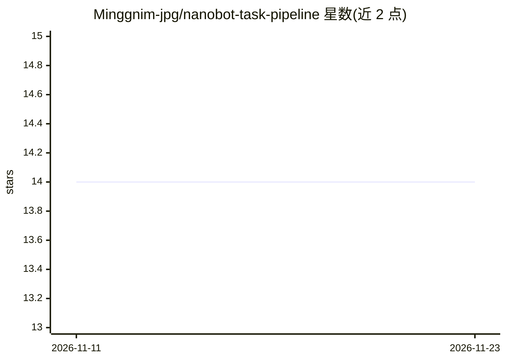

# Minggnim-jpg/nanobot-task-pipeline

⭐ 14 · Shell · MIT · 推送 2026-11-11 · [GitHub](https://github.com/Minggnim-jpg/nanobot-task-pipeline) · 个人维护 · 中文 README

**给开发者的 nanobot+Claude Code 多阶段编码任务流水线**

基于 nanobot 与 Claude Code 的自动化任务执行引擎：任务按 brainstorming → technical-spec → coding → review → PR 五阶段流转，由心跳轮询调度多个子代理，并发限制 5 个、单阶段 1 小时超时。支持搭建期（每阶段人工确认）与正式期（自动流转）两种模式，保留完整执行历史；经 Discord 回复 "OK" 推进关键节点。开源仓库已脱敏，部署前需替换占位符；心跳调度为可选组件，也可用 cron 或手动脚本触发。README 未提供统一安装命令。

## 筛选速览

| 维度 | 判定 | 备注 |
|---|---|---|
| AI 角色 | `ai-ecosystem` | LLM/agent 周边工具 |
| 许可风险 | `permissive` | MIT |
| 部署形态 | `None` |  |
| 模型依赖 | — | README 未给出锁定关系 |
| 硬件要求 | — | 无带数字的原话,不猜 |
| 安装摩擦 | `low` | 无编译、无系统依赖或容器化 |
| 成熟度 | — | 结构信号不足 |

## 能力要点

- 五阶段流水线：需求澄清、技术方案、编码、审查、PR 自动流转
- 心跳轮询调度（默认 5 分钟），并发子代理上限 5 个，1 小时超时保护
- 搭建期/正式期双运行模式与 Discord 确认机制
- 每任务保留完整执行历史与输出文件，便于审计

## 适用场景

- 用 Claude Code 子代理自动化跑完从需求到 PR 的编码任务
- 限制并发代理数量避免本机资源耗尽
- 需要人工在需求与 PR 关键节点确认的半自动开发流程

## 场景标签

`编码 Agent` `工作流自动化` · 领域:效率与自动化

## 证据(README 行号)

> L3: > 🤖 基于 nanobot + Claude Code 的自动化任务执行引擎
> L16: 任务流水线系统是一个自动化的任务执行引擎，通过心跳轮询机制调度多个子代理，按阶段完成编码任务。
> L22: |**多阶段流水线**|brainstorming → technical-spec → coding → review → PR 五阶段自动流转|

## 星数曲线

2026-11-11 14 → 2026-11-23 14（+0）

---
*卡片 v1 · prompt 1.4 · 生成 2026-11-18 · 置信度 high · 依据 README sha `0c30db61ba22` · [字段定义](../../DATASET.md)*
