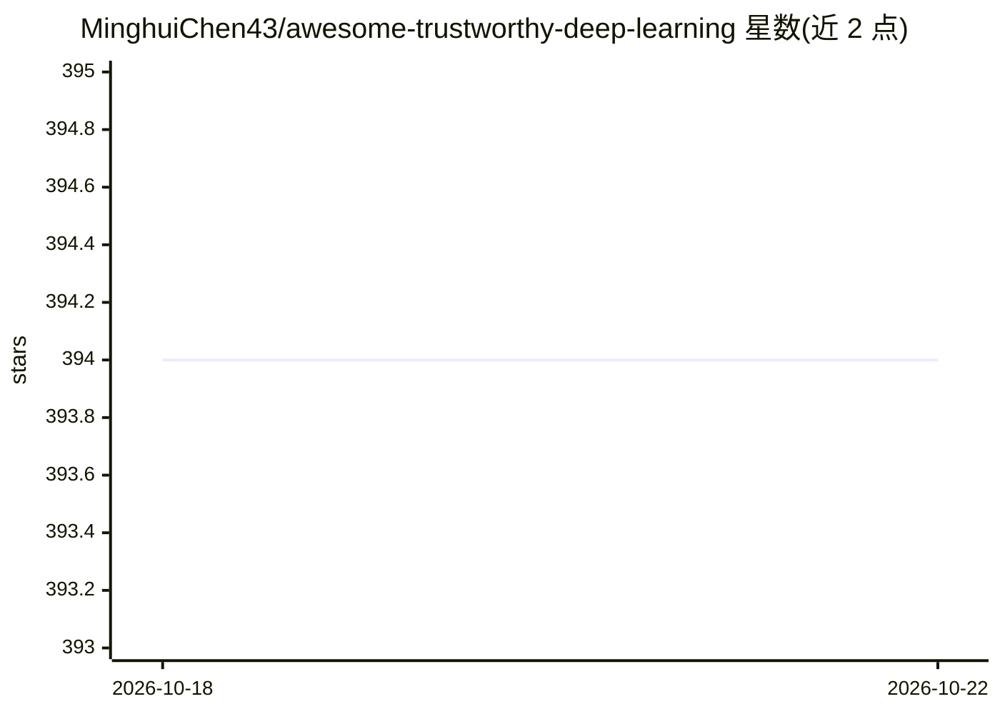

# MinghuiChen43/awesome-trustworthy-deep-learning

⭐ 394 · MIT · 推送 2026-08-11 · [GitHub](https://github.com/MinghuiChen43/awesome-trustworthy-deep-learning) · 个人维护

**可信深度学习论文策展清单：覆盖对抗、后门、隐私等方向**

持续更新的可信深度学习研究论文清单，覆盖分布外泛化、对抗攻击与防御、投毒攻击、隐私泄露、机器遗忘、可解释性等主题。每条目含论文链接、作者、关键词与内容摘要，部分附代码仓库；从 ArXiv 每日更新，预览 README 仅收录近一年提交的论文，更早内容通过 Full List 查看。面向科研人员与安全研究者做文献追踪。

## 筛选速览

| 维度 | 判定 | 备注 |
|---|---|---|
| AI 角色 | `ai-knowledge` | 知识聚合/清单类 |
| 许可风险 | `permissive` | MIT |
| 部署形态 | `None` |  |
| 模型依赖 | — | README 未给出锁定关系 |
| 硬件要求 | — | 无带数字的原话,不猜 |
| 安装摩擦 | `low` | 无编译、无系统依赖或容器化 |
| 成熟度 | — | 结构信号不足 |

## 能力要点

- 按主题分类组织（OOD 泛化、对抗攻击、投毒、隐私等）
- 每日从 ArXiv 更新，条目附关键词与摘要
- 预览仅含近一年论文，完整清单另存

## 适用场景

- 追踪可信深度学习各子方向的新论文
- 按关键词摘要快速筛选相关研究
- 查找附带开源代码的攻击/防御方法论文

## 场景标签

`科研工具` `精选清单` · 领域:学习与行业

## 证据(README 行号)

> L11: The deployment of deep learning in real-world systems calls for a set of complementary technologies that will ensur
> L13: Daily updating from ArXiv. The preview README only includes papers submitted to ArXiv within the **last one year**.

## 星数曲线

2026-10-18 394 → 2026-10-22 394（+0）

---
*卡片 v1 · prompt 1.4 · 生成 2026-10-21 · 置信度 high · 依据 README sha `bd398c7d241a` · [字段定义](../../DATASET.md)*
