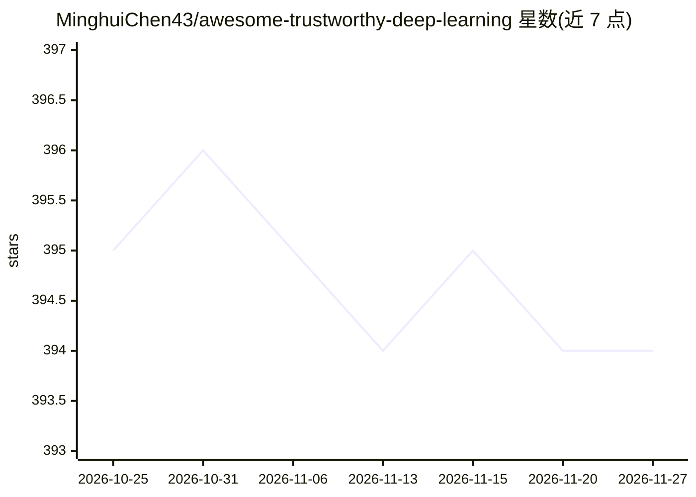

# MinghuiChen43/awesome-trustworthy-deep-learning

⭐ 394 · MIT · 推送 2026-11-26 · [GitHub](https://github.com/MinghuiChen43/awesome-trustworthy-deep-learning) · 个人维护

**面向 AI 研究者的可信深度学习论文聚合清单**

按主题组织的可信深度学习论文列表，覆盖分布外泛化、逃逸攻击与防御、投毒攻击与防御、隐私等研究方向，每条条目附论文链接、作者、关键词与摘要式 Digest，部分条目附代码仓库链接。内容每日从 ArXiv 更新，预览 README 只收录最近一年提交的论文，完整列表另行维护。维护者欢迎 PR 投稿。

## 筛选速览

| 维度 | 判定 | 备注 |
|---|---|---|
| AI 角色 | `ai-knowledge` | 知识聚合/清单类 |
| 许可风险 | `permissive` | MIT |
| 部署形态 | `None` |  |
| 模型依赖 | — | README 未给出锁定关系 |
| 硬件要求 | — | 无带数字的原话,不猜 |
| 安装摩擦 | `low` | 无编译、无系统依赖或容器化 |
| 成熟度 | — | 结构信号不足 |

## 能力要点

- 按研究方向分类组织论文条目（OOD 泛化、对抗攻击、隐私等）
- 每条论文附关键词与 Digest 摘要，部分附代码链接
- 每日从 ArXiv 更新，预览版收录近一年论文
- 提供各分类的 Full List 完整清单

## 适用场景

- 查找可信机器学习各方向的最新论文
- 调研 LLM 越狱攻击与防御相关工作
- 为综述写作收集对抗样本、机器遗忘等主题文献

## 场景标签

`精选清单` · 领域:学习与行业

## 证据(README 行号)

> L9: # Awesome Trustworthy Deep Learning Awesome
> L11: The deployment of deep learning in real-world systems calls for a set of complementary technologies that will ensur
> L13: Daily updating from ArXiv. The preview README only includes papers submitted to ArXiv within the **last one year**.

## 星数曲线

2026-10-25 395 → 2026-11-27 394（-1）

---
*卡片 v1 · prompt 1.4 · 生成 2026-11-27 · 置信度 high · 依据 README sha `f7ea10bd8175` · [字段定义](../../DATASET.md)*
