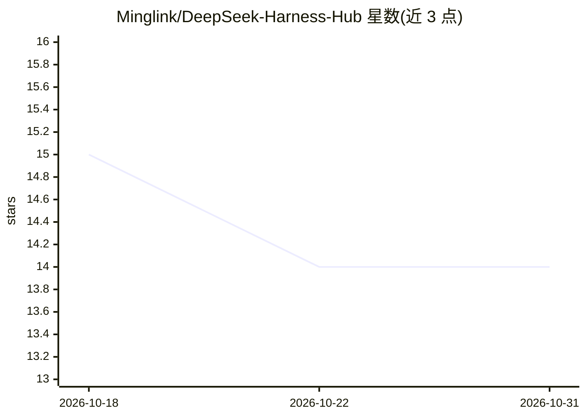

# Minglink/DeepSeek-Harness-Hub

⭐ 14 · MIT · 推送 2026-08-25 · [GitHub](https://github.com/Minglink/DeepSeek-Harness-Hub) · [官网](https://deepseek.stream) · 个人维护 · 中文 README

**DeepSeek 生态插件市场与一键安装协议规范文档**

面向 DeepSeek 大模型与 DeepSeek Harness (DSH) 生态的开源插件市场仓库：主站 deepseek.stream 汇聚扩展、自动化 Agent、代码生成辅助与 Prompt 模板等条目，配套桌面客户端 (EXE) 与 `dsh://plugin/install` 自定义协议实现网页一键装载，另提供 CLI 命令安装方式（dsh plugin add）。README 同时定义协议 URL 规范、一键安装徽章代码与前端触发函数，供插件作者接入；还含社区论坛与悬赏中心的介绍。本仓库本身为使用指南与规范文档，桌面客户端在另一仓库发布。

## 筛选速览

| 维度 | 判定 | 备注 |
|---|---|---|
| AI 角色 | `ai-ecosystem` | LLM/agent 周边工具 |
| 许可风险 | `permissive` | MIT |
| 部署形态 | `desktop` | 安装包/桌面程序 |
| 模型依赖 | locked-api |  |
| 硬件要求 | — | 无带数字的原话,不猜 |
| 安装摩擦 | `low` | 无编译、无系统依赖或容器化 |
| 成熟度 | — | 结构信号不足 |

## 能力要点

- `dsh://` 自定义协议规范：URL 格式、Markdown/HTML 徽章、前端触发函数
- 桌面客户端 (EXE) 网页一键装载与 CLI 安装两种方式
- 插件条目覆盖扩展、Agent、代码辅助、Prompt 模板
- 维护 dsh-plugin 等 GitHub Topic 标签体系

## 适用场景

- 查找并一键安装 DeepSeek Harness 生态插件
- 为自己的开源项目添加 dsh:// 一键安装徽章
- 了解 dsh 协议规范以开发 DSH 插件

## 场景标签

 · 领域:AI 工具生态/插件分发

## 证据(README 行号)

> L21: **DeepSeek Harness Hub** 是专为 **DeepSeek** 大模型与 **DeepSeek Harness (DSH)** 生态打造的现代化开源插件市场与开发者交流社区。
> L29: |**⚡ 一键极速装载**|深度集成系统级 `dsh://plugin/install?...` 自定义协议，网页或文档一键拉起桌面端 (EXE)，0 门槛自动装载。|

## 星数曲线

2026-10-18 15 → 2026-10-31 14（-1）

---
*卡片 v1 · prompt 1.4 · 生成 2026-10-31 · 置信度 mid · 依据 README sha `95ff0790cc5c` · [字段定义](../../DATASET.md)*
