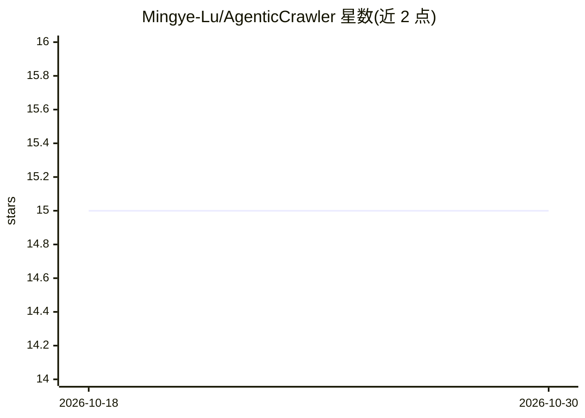

# Mingye-Lu/AgenticCrawler

⭐ 15 · Rust · MIT · 推送 2026-10-28 · [GitHub](https://github.com/Mingye-Lu/AgenticCrawler) · 个人维护

**给开发者的自然语言网页抓取与浏览器自动化 agent**

单个 Rust 二进制 acrawl：用户用英文描述目标，LLM agent 驱动 43 个工具完成导航、点击、表单填写与结构化数据提取，并可观察网络请求、控制台、性能与无障碍审计。支持 25 个 LLM 提供商（含 OpenAI 兼容端点如 Ollama），内置 MCP server 供 Claude Code、Cursor 等客户端调用；抓取可保存为确定性 JSON 脚本，无模型调用地重放。JavaScript 重页面经 CloakBrowser 处理，浏览器功能需 Node.js 20+。

## 筛选速览

| 维度 | 判定 | 备注 |
|---|---|---|
| AI 角色 | `ai-native` | 本体是模型或模型工具 |
| 许可风险 | `permissive` | MIT |
| 部署形态 | `library` | 以包/库形式分发 |
| 模型依赖 | local-ok | 支持本地模型 |
| 硬件要求 | — | 无带数字的原话,不猜 |
| 安装摩擦 | `medium` | 含编译或系统依赖之一 |
| 成熟度 | — | 结构信号不足 |

## 能力要点

- 自然语言目标驱动的浏览器 agent，43 个工具、25 个 LLM 提供商
- 内置 MCP server，可被 Claude Code/Cursor/VS Code 等 17 个客户端调用
- 抓取可存为确定性 JSON 脚本，无 LLM 调用地重放
- HTTP 优先、按需切换 CloakBrowser 真实浏览器

## 适用场景

- 用一句话描述字段，从任意网站批量抓取结构化数据
- 让 agent 打开页面、走完流程并报告失败请求与原因
- 把抓取流程固化为脚本，从 cron/CI 免费重放

## 场景标签

`浏览器自动化` `网页抓取` · 领域:效率与自动化

## 证据(README 行号)

> L24:  Single Rust binary. Full DevTools observability. 43 tools. 25 LLM providers. MCP server built-in.
> L32: acrawl reads the goal, opens the site, works out the pagination and hands back JSON. Along the way the agent can wa

## 星数曲线

2026-10-18 15 → 2026-10-30 15（+0）

---
*卡片 v1 · prompt 1.4 · 生成 2026-10-30 · 置信度 mid · 依据 README sha `a94bf4054916` · [字段定义](../../DATASET.md)*
