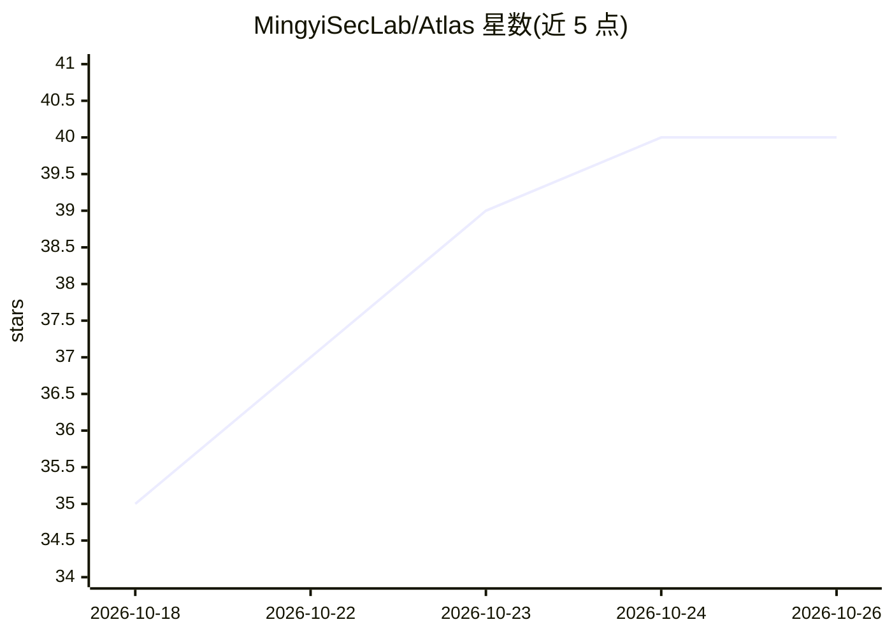

# MingyiSecLab/Atlas

⭐ 40 · TypeScript · NOASSERTION · 推送 2026-10-18 · [GitHub](https://github.com/MingyiSecLab/Atlas) · 组织维护 · 中文 README

**本地 AI 安全评估智能体桌面应用，带可视化渗透测试工作流**

基于 Electron 的本地优先 AI Agent 桌面应用（Atlas/Mingyi）：将 AgentController、统一模型路由、多工作模式、MCP 协议、工具流水线与会话状态持久化封装为开源 Runtime（packages/runtime），桌面端通过类型完备的 IPC 协议调用。面向授权安全评估场景提供渗透测试可视化工作流，配合 Docker Kali 沙箱（内置 Kali 工具链、PoC 库与 HackTricks 知识库）隔离执行 kali_* 工具。支持公有云 API 与 Ollama/vLLM/LocalAI 等本地端点统一路由，项目数据存于 .mingyi/pentest/ 可与 Git 协同。开源核心 AGPLv3，另提供商业许可证；项目自述处于 Alpha 早期阶段，架构随时可能重构。

## 筛选速览

| 维度 | 判定 | 备注 |
|---|---|---|
| AI 角色 | `ai-native` | 本体是模型或模型工具 |
| 许可风险 | `none` | NOASSERTION |
| 部署形态 | `self-host` | docker 或自建部署 |
| 模型依赖 | local-ok | 支持本地模型 |
| 硬件要求 | — | 无带数字的原话,不猜 |
| 安装摩擦 | `low` | 无编译、无系统依赖或容器化 |
| 成熟度 | `idea` | |

## 能力要点

- AgentController Runtime + 类型完备 IPC 协议的 Electron 桌面应用
- Docker Kali 沙箱隔离执行渗透测试工具链与 PoC 库
- 统一模型路由支持公有云 API 与 Ollama/vLLM/LocalAI 本地端点
- 原生 MCP 客户端管理器与安全工具/技能双轨扩展机制

## 适用场景

- 我在授权渗透测试中需要可视化工作流跟踪执行链路与漏洞发现
- 我想在本地沙箱中隔离运行自动化安全评估任务
- 我需要可切换多厂商/本地模型服务的桌面 Agent 工作台

## 场景标签

`网络安全` `Agent 框架` · 领域:Agent 开发

## 证据(README 行号)

> L5: Mingyi 是一个基于 Electron 的本地 AI Agent 桌面应用：将现代化本地 AI Agent 的 AgentController、统一模型路由、多工作模式、扩展中心与插件、安全工具、MCP 及会话状态流封装成本地通
> L62: - `packages/runtime/`：通用的本地 AI Agent 核心 Runtime，提供 AgentController、Session、统一模型路由、模式（Mode）、Subagent、工具执行、MCP 协议支持、技
> L88:  Agent 在执行前会自动调用内置的 `detect_sandbox_environment` 工具探测当前环境。只有在触发 `kali_*` 系列工具时才向沙箱下发执行指令，未启用时零资源开销；

## 星数曲线

2026-10-18 35 → 2026-10-26 40（+5）

---
*卡片 v1 · prompt 1.4 · 生成 2026-10-25 · 置信度 mid · 依据 README sha `617624d7c147` · [字段定义](../../DATASET.md)*
