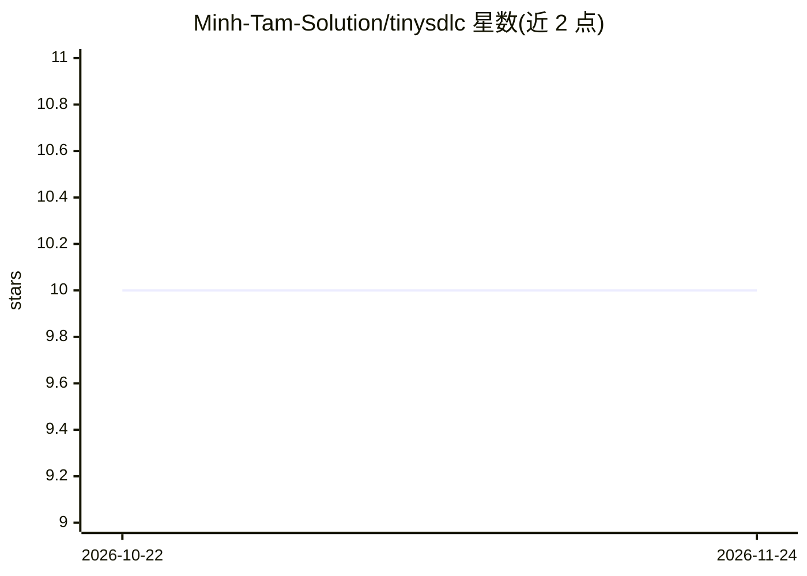

# Minh-Tam-Solution/tinysdlc

⭐ 10 · TypeScript · MIT · 推送 2026-02-22 · [GitHub](https://github.com/Minh-Tam-Solution/tinysdlc) · 组织维护

**给个人/小团队的 SDLC 多 agent AI 编排器，经消息渠道协作**

通过文件消息队列把 Discord、WhatsApp、Telegram、Zalo 等消息渠道接入 AI agent：内置 8 个 SDLC 角色（researcher/pm/architect/coder/reviewer/tester/devops 等）与 4 个团队原型，agent 在隔离工作区运行，通过链式执行与并行 fan-out 协作，含质量门与职责分离约束（如 reviewer 不得自批代码）。支持 Anthropic Claude、OpenAI Codex、Ollama 三种后端，依赖 Node.js 14+、tmux、Bash 4.0+ 与 Claude Code/Codex CLI，仅支持 macOS/Linux。

## 筛选速览

| 维度 | 判定 | 备注 |
|---|---|---|
| AI 角色 | `ai-ecosystem` | LLM/agent 周边工具 |
| 许可风险 | `permissive` | MIT |
| 部署形态 | `library` | 以包/库形式分发 |
| 模型依赖 | local-ok | 支持本地模型 |
| 硬件要求 | — | 无带数字的原话,不猜 |
| 安装摩擦 | `low` | 无编译、无系统依赖或容器化 |
| 成熟度 | — | 结构信号不足 |

## 能力要点

- 8 个 SDLC 角色与 4 个团队原型，首次设置时自动创建
- 文件消息队列机制，支持链式执行与并行 fan-out（含 50 条消息循环防护）
- 支持 Claude、Codex CLI 与本地 Ollama 三种 provider
- 接入 Discord/Telegram/WhatsApp/Zalo 四类消息渠道

## 适用场景

- 在 Discord/Telegram 等聊天工具里指挥多角色 agent 协作完成编码任务
- 按 SDLC 职责分离流程管理代码生成、评审与测试
- 用本地 Ollama 模型运行 agent 团队

## 场景标签

`多智能体` `编码 Agent` `代码生成` · 领域:Agent 开发

## 证据(README 行号)

> L3: Multi-agent AI Orchestrator with SDLC Governance.
> L12: TinySDLC connects messaging channels to AI agents through a file-based message queue. Agents are organized into tea
> L14: Three AI providers are supported: Anthropic Claude, OpenAI Codex, and Ollama (local models). Each agent operates in

## 星数曲线

2026-10-22 10 → 2026-11-24 10（+0）

---
*卡片 v1 · prompt 1.4 · 生成 2026-11-20 · 置信度 high · 依据 README sha `67e98f3267cf` · [字段定义](../../DATASET.md)*
